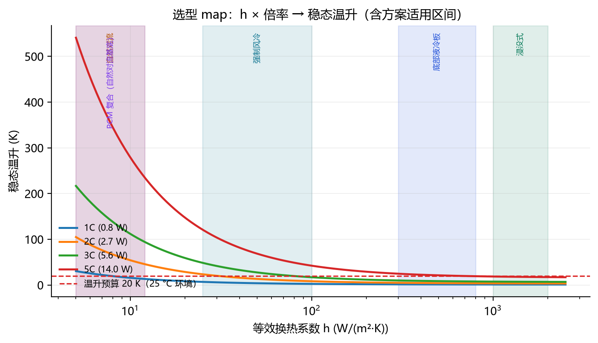

<div align="center">

# 电池热管理与冷却方案仿真评估（A5）
### 纯仿真回答两个问题：产热有多大、怎么冷——选型 map + 寿命账 + 深段失效机制

[](https://github.com/ilo-love7/battery-thermal-management/actions/workflows/ci.yml)
[](LICENSE)


<p align="center">
  
</p>

</div>

---

热管理设计前期的低成本评估：不搭台架，用 PyBaMM 电化学-热耦合仿真 + 两节点热网络 + Arrhenius 损伤积分，
从单体产热一路算到冷却方案选型与寿命账。输入一个倍率与换热系数 h，输出温升、方案分档与相对寿命。

**先看这 5 件事：**

1. **产热近似平方律，但构成在 2C/3C 间切换**：Q ≈ 0.782·C^1.79 W（R²=0.99997）；3C 以上可逆熵热反超（占 62–70%），**热设计不能只按 I²R 估**（报告 §2）
2. **冷却分档边界清晰**：1C 靠自然对流勉强、2C 是强制风冷上限、3C 起必须液冷、5C 连液冷都贴线——所需 h 从 7.7 跳到 638 W/(m²·K)，两个数量级（§3）
3. **表面温度会骗人**：21700 卷芯径向芯-壳温差 2C 时 3 K、5C 极端组合下 34.6 K；叠片方向只有 0.8 mK。老化按芯温算，热电偶在表面（§4）
4. **冷却方案的寿命账**：3C 工况下自然对流 → 液冷板相对寿命 **4.6×**（Ea=45 kJ/mol，30/45/60 三档齐报）；用平均温度代替温度历程会低估损伤 27–74%（§5）
5. **深段加速是三线合流**：fade>25% 后分带速率 **7.2×**、阻抗每 % fade 代价抬升 **2.4×**、V(Q) shape 份额 0.70→0.90——活性材料损失/阻抗正反馈图景（v1.16 §91–93）

---

## 数据

| 数据集 | 角色 | 许可 | 位置 |
|---|---|---|---|
| Chen2020（PyBaMM 参数集，LGM50 21700） | 热学主参数集 | PyBaMM 内置 | `src/bmthermal/params.py` |
| Mohtat2020（5 Ah 软包） | 高倍率/可逆热交叉验证 | PyBaMM 内置 | 同上 |
| CALCE A123 26650 LFP | US06 实测工况 + 温箱脉冲 + CS2 循环老化对标 | 公开（UMD） | `data/us06_crate.csv`（1 Hz 标幺倍率，经 A4 数据层复用） |
| Sandia SNL | 日历/循环分解、跨体系外推验证、post-mortem RPT | 公开 | `D:\项目\02_数据集\`（zip 直读） |
| Oxford 电池老化组 | EIS 深度耦合 + V(Q) 两模式分解（G1–G5 至 69–82% 深度） | 公开 | 同上 |

参数边界（所有结论的前提）：Chen2020 熵变系数恒为 0（可逆热恒 0，用 Mohtat2020 补）；
DFN+Chen2020 在 3C 只交付 38% 容量（电解液耗尽）——3C 以上产热用「Mohtat 形状 × 标度律幅度」；
两套参数集**不混用**（§1）。

## Results

**核心选型表**（允许温升 20 K、25 °C 环境、连续放电到 3.0 V；产热=Mohtat 形状×标度律幅度，温升=集总热容稳态估算，`results/metrics/01_heat_sweep.json` + `02_required_h.json`）：

| 倍率 | 产热功率 | 所需 h〔W/(m²·K)〕 | 自然对流 | 强制风冷 | 底部液冷板 | 浸没式 |
|---|---|---|---|---|---|---|
| 0.5C | 0.23 W | 2.2 | +5.6 K ✓ | +1.1 K ✓ | +0.3 K ✓ | +0.3 K ✓ |
| 1C | 0.78 W | 7.7 | +19.3 K △ | +3.8 K ✓ | +1.2 K ✓ | +1.0 K ✓ |
| 2C | 2.7 W | 30 | **+67 K ✗** | +13.3 K ✓ | +4.1 K ✓ | +3.4 K ✓ |
| 3C | 5.6 W | 77 | **+138 K ✗** | **+27 K ✗** | +8.5 K ✓ | +7.1 K ✓ |
| 5C | 14.0 W | 638 | **+345 K ✗** | **+68 K ✗** | **+21 K ✗** | +17.6 K △ |

✓=有裕度 △=贴线 ✗=不可用。选型 map 全曲线即首页图（`results/figures/02b_selection_map.png`）。

**寿命账**（3C 连续放电，相对「自然对流 1C」基线的 Arrhenius 损伤积分，`results/metrics/05_aging.json`）：
液冷板 **4.6×**、浸没 4.9×、PCM 2.6×、强制风冷 2.5×。Ea 敏感性 30/45/60 kJ/mol 三档齐报——
寿命比随 Ea 单调放大，但方案排序不变（`15_life_uncertainty.json`）。

**芯温才是老化温度**（`results/figures/04a_module_field.png`）：两节点模型给出芯-壳温差 3–16 K（1–3C），
「5C + 45 °C + 液冷板」极端组合下表面 56 °C / 芯部 91 °C——表面贴线时芯部已过 80 °C 报警线。
BMS 需要芯温估计器而非表面查表（`14_observer.json`）。

**深段失效机制三线**（v1.16，`results/metrics/55_deep_fade.json` + `56_deep_modes.json`）：
G5 三芯（fade 至 69–82%）的 fade 分带速率在 >25% 深段加速 7.2×（17.9 vs 2.47 %/100 EFC）；
EIS 侧 ΔR_pol/Δfade 晚段是早段的 2.4×（2.62→7.25 mΩ/%）；V(Q) 两模式分解 shape 份额
浅段 0.70 → 深段 0.90（γ 0.069→0.568，类 LAM 加速）。三线共变但非锁定——
与「fade 后段放缓而阻抗加速」的解耦图景拼合（§94）。

**安全边界由散热退化决定**（`06_safety.json`）：5C+45 °C+液冷板在泵/流道退化到 30% 时芯温 105 °C，
距 80 °C 报警只剩 620–640 s ≈ 一个 US06 循环——快充 + 高温 + 散热退化**叠加**才是设计边界。

## Quick start

```bash
git clone https://github.com/ilo-love7/battery-thermal-management.git
cd battery-thermal-management
pip install -e ".[dev]"        # PyBaMM 26.10 + numpy/scipy/pandas/matplotlib/pytest

pytest tests -q                # 289 项物理一致性测试，不依赖数据集
bash run_all.sh                # 生成全部指标（results/metrics/）与图（results/figures/）
```

结论与数字在 `reports/基准评测报告-A5.md`（一页纸结论 §0），过程与坑在 `reports/工作记录-A5.md`。

## Bring your own data

换工况：`data/us06_crate.csv` 是 1 Hz 标幺倍率剖面（列 `crate`），替换成你的功率/倍率时间序列即可复用
全部热网络与寿命管线（`src/bmthermal/duty.py`）。换电芯：改 `src/bmthermal/params.py` 的参数集
（需要带热学键的 PyBaMM 参数集；x-full 热模型缺极耳/表面换热键时 `network.py` 自动补参重试）。
公开行车数据做热网络标定**不可行**——结构性不可辨识（§13）；标定需设计激励
（电加热膜 + 埋入式测点 + 恒功率脉冲 ≥3τ）。

## How it works

1. **产热分解**（`heat.py`）：PyBaMM DFN 仿真欧姆/极化/可逆熵热，拟合标度律 Q(C)
2. **热网络**（`network.py`）：集总热容 + 两节点（芯-壳）热阻网络，稳态/动态温升
3. **选型 map**（`guide_map.py`）：h_req = 1/(A(ΔT/Q − R_int)) 解析骨架 + 数值扫参
4. **寿命积分**（`aging.py` / `abs_life.py`）：Arrhenius 损伤沿温度历程积分，输出相对寿命比
5. **机制深挖**（`eis_features.py` / `degrade_modes.py` 等）：EIS 阻抗-深度耦合、V(Q) 两模式分解、日历-循环分解

## Reproduce

```bash
# v1.0 主线（产热 → 选型 map → 温度场 → 寿命账 → 模组 → 安全 → 动态工况）
python scripts/01_heat_analysis.py && python scripts/02_cooling_sweep.py && \
python scripts/03_gradient_ident.py && python scripts/04_module.py && \
python scripts/05_aging.py && python scripts/06_safety.py && python scripts/07_duty.py

# v1.1–v1.12 深化（标定可行性 / PCM / 观测器 / 寿命不确定度 / 沸腾边界 / 接触热阻 / 老化反馈 / CS2 对标…）
python scripts/10_calib_real.py    # 其余 11–48 按版本分组，见 run_all.sh

# v1.13–v1.16 机制侧（EIS EoL / fade-EoL / 静置剂量 / SOC 轴 / EFC 口径 / 深段加速三线）
python scripts/55_deep_fade.py && python scripts/56_deep_modes.py
```

完整清单按版本分组见 `run_all.sh`（00–56，一键全跑）。

## Layout

```
src/bmthermal/    35 个可复用模块（heat/network/guide_map/aging/…/degrade_modes）
scripts/          00–56 分析流水线（每脚本一个可独立运行的分析）
tests/            物理一致性/单元测试 289 项（不依赖数据集）
reports/          基准评测报告（结论）+ 工作记录（过程与坑）
results/metrics/  全部数字的 JSON/CSV 出处（报告可溯源）
results/figures/  全量产出图（63 张）
docs/figures/     README 展示用精选图
data/             us06_crate.csv（1 Hz 标幺倍率工况）
```

## 边界与负结果

1. **公开行车数据标定热网络结构性不可辨识**：τ 剖面似然平坦（160 倍 RMSE 只变 0.03 K < 量化噪声）——不是"精度差一点"，是信息不够（§13）
2. **PCM 等效热容法低估峰值**：潜热永久摊入热容；焓法才是悲观侧。3C 以上必须焓法（§18）
3. **参数集边界**：Chen2020 可逆热恒 0、3C 只交付 38% 容量——数字边界内有效（§1）
4. **寿命比带口径**：C5 寿命比 4.77×→2.14×（−55%）源于"热秒数"口径给高倍率打日历折扣——份额口径必问"定义在哪个时长"（§30–34）
5. **跨体系外推收窄**：绝对寿命锚点只在 CS2 类 1.1 Ah 方形 LFP 验证（留一误差中位 22%）；共享振幅假设在 LFP/NMC 双向失效（×2.30 / ×0.64）（§26、§38）
6. **几何归属 ≠ 拆解位点**：V(Q) 两模式（shift/shape→LLI/LAM）是文献惯例映射，不是电极级拆解（v1.16）

## Going deeper

<details>
<summary>v1.1–v1.12 · 标定 / PCM / 观测器 / 寿命不确定度 / 沸腾边界 / 接触热阻 / 老化反馈 / CS2 对标</summary>

CALCE 温度通道结构性不可辨识（§13）；PCM 焓法 vs 等效热容分歧（§18）；US06 观测器芯-壳 gap 估计（§19）；
寿命比 Monte Carlo 不确定带（§20）；沸腾边界与导热垫接触热阻（§21–22）；老化-热正反馈（§23）；
CS2 实测对标：绝对循环数留一误差中位 22%、衰减指数 b 中位 0.76（§26）。指标 `10–28_*.json`。

</details>

<details>
<summary>v1.13–v1.16 · EIS EoL / 静置剂量 / SOC 因子轴 / EFC 口径 / 深段加速机制三线</summary>

EIS 特征到 EoL 的阻抗链归因（后段 63%）；90% SOC 静置是加伤非恢复；SOC 窗口因子轴 4.2 V +1.37 pp；
EFC=放电 Ah/q_bol 统一口径；深段加速三线（7.2×/2.4×/0.70→0.90，§91–94）。指标 `49–56_*.json`。

</details>

## Citation & licence

```bibtex
@software{battery_thermal_management_2026,
  author = {ilo-love7},
  title  = {电池热管理与冷却方案仿真评估（A5）},
  year   = {2026},
  url    = {https://github.com/ilo-love7/battery-thermal-management}
}
```

MIT License · 仿真框架 [PyBaMM](https://pybamm.org)（BSD-3）；CALCE/SNL/Oxford 数据集许可见各数据集原文。
