# 电池热管理与冷却方案仿真评估（A5）—— 基准评测报告

> 版本 1.11.0 · 2026-11-03（v1.0 §1–11 + v1.1 §12–17 + v1.2 §18–23 + v1.3 §24–29 + v1.4 §30–35 + v1.5 §36–40 + v1.6 §41–45 + v1.7 §46–50 + v1.8 §51–55 + v1.9 §56–60 + v1.10 §61–65 + v1.11 §66–70）
> 代码：`src/bmthermal/`（31 个模块）+ `scripts/00–07`（v1.0）+ `scripts/10–13`（v1.1）+ `scripts/14–17`（v1.2）+ `scripts/18–21`（v1.3）+ `scripts/22–25`（v1.4）+ `scripts/26–28`（v1.5）+ `scripts/29–31`（v1.6）+ `scripts/32–34`（v1.7）+ `scripts/35–37`（v1.8）+ `scripts/38–40`（v1.9）+ `scripts/41–43`（v1.10）+ `scripts/44–46`（v1.11）
> 指标：`results/metrics/*.json|csv`；图：`results/figures/*.png`（53 张）
> 模型：PyBaMM 26.10 电化学-热耦合（DFN 为主）+ 两节点热网络 + Arrhenius 损伤积分
> 参数：Chen2020（LGM50 21700，热学主参数集）+ Mohtat2020（5 Ah 软包，高倍率交叉验证）
> 工况：CALCE A123 实测 US06 剖面（经 A4 数据层复用，1 Hz 标幺倍率）

---

## 0. 一页纸结论

**核心选型表**（允许温升 20 K、25 °C 环境、连续放电到 3.0 V）：

| 倍率 | 产热功率 | 所需 h〔W/(m²·K)〕 | 自然对流 | 强制风冷 | 底部液冷板 | 浸没式 |
|---|---|---|---|---|---|---|
| 0.5C | 0.23 W | 2.2 | +5.6 K ✓ | +1.1 K ✓ | +0.3 K ✓ | +0.3 K ✓ |
| 1C | 0.78 W | 7.7 | +19.3 K △ | +3.8 K ✓ | +1.2 K ✓ | +1.0 K ✓ |
| 2C | 2.7 W | 30 | **+67 K ✗** | +13.3 K ✓ | +4.1 K ✓ | +3.4 K ✓ |
| 3C | 5.6 W | 77 | **+138 K ✗** | **+27 K ✗** | +8.5 K ✓ | +7.1 K ✓ |
| 5C | 14.0 W | 638 | **+345 K ✗** | **+68 K ✗** | **+21 K ✗** | +17.6 K △ |

*表：产热为 Mohtat2020 形状 × 标度律幅度（§2）；温升为集总热容稳态估算（§3）。✓=有裕度 △=贴线 ✗=不可用。*

六条结论：

1. **产热随倍率近似平方增长，但构成在 2C/3C 之间发生切换。**
   0.5–2C 由不可逆热主导（欧姆 33%→47%，极化 67%→53%），标度律
   Q ≈ 0.782·C^1.79 W（R²=0.99997）。3C 以上**可逆熵热反超**（占 62–70%），
   且 Mohtat2020 的熵变系数在部分 SOC 区间为负（放电吸热窗口）。
   工程含义：**3C 以上的热设计不能只按 I²R 估**，否则漏掉一半以上的热。
2. **「只看表面温度」在高倍率下会系统性漏判。** 叠片（穿厚）方向温差实测只有
   0.0008 K——真正的梯度在**卷芯径向**：两节点模型给出芯-壳温差 3–16 K
   （1–3C），而在「5C + 45 °C + 液冷板」极端组合下芯-壳温差达 **34.6 K**
   （表面 56 °C / 芯部 91 °C）。表面贴 45 °C 合格时，芯部已经在 80 °C 报警线之上。
3. **冷却方案的分档边界很清晰：1C 靠自然对流勉强、2C 是强制风冷的上限、
   3C 起必须液冷、5C 连液冷都贴线。** 允许温升 20 K 时所需 h 从 1C 的 7.7
   跳到 5C 的 638 W/(m²·K)，两个数量级——不是"加强一点风"能补的。
4. **选冷却方案本质是算寿命账（D2）。** 3C 连续放电下，自然对流芯温 111 °C
   （已超模型域），液冷板 43.5 °C；按 Arrhenius 损伤积分折算，
   相对「自然对流 1C」基线的寿命比：液冷板 **4.6×**、浸没 4.9×、
   强制风冷 2.5×、PCM 2.6×。**用"平均温度"代替温度历程会低估损伤 27–74%**
   （5C 自然对流下寿命高估近 3 倍），液冷板只有 1.5–17% 的偏差——
   温度越平稳，简化算法越可信。
5. **模组级一致性不是问题，流量也不是。** 2×6 模组（底部液冷板，h=500、
   接触面积 25%）在 3C 下 ΔT_max 从 0.5 L/min 的 2.5 K 降到 4 L/min 的
   0.3 K，**全部满足 ΔT ≤ 5 K 指标**；满足指标所需流量仅 0.47 L/min。
   产热打 1.5 倍余量时 ΔT 也只有 0.36 K。一致性瓶颈不在流量，在接触热阻
   （等效 h）和芯-壳内阻。
6. **安全边界由"散热退化"而不是"散热能力"决定。** 5C + 45 °C + 液冷板、
   散热能力完好时芯温 91 °C（已超 80 °C 报警，但仍在模型域内）；
   泵/流道退化到 50% 时 97 °C、到 30% 时 105 °C，且**距 80 °C 只剩
   620–640 s**——约一个 US06 循环的长度。**快充 + 高温 + 散热退化三者叠加
   才是设计边界**，单一维度都过不了关。

**不确定性声明（必须随结论一起读）**：两套参数集（Chen2020 / Mohtat2020）
在 1–2C 的产热差 1.9–2.9 倍（§2.3），所以上表的绝对温度有 ±5–10 K 量级的
不确定度；**但"哪档倍率需要哪级冷却"的分档结论是稳健的**（两套参数都指向
同一分档）。3C 以上的 Q 用标度律外推 + Mohtat 形状合成，偏差 −25%~−2%
（§2.4）。60/80 °C 是工程预警阈值，不是热失控起始温度（热失控链式反应属
B3 范围，本项目不建模）。

> **v1.4 口径修订注记（必须叠加到上面第 4/5 条）**：
> ① 第 4 条的寿命比（液冷板 4.6×、C5 4.7×）是**日历机制缺失口径下的上界**——
> 日历-循环分解后主口径 **2.1×**（闭式 CI [1.8, 4.8]×），见 §31；
> ② 第 5 条"一致性不是问题"成立于**设计流量**；流量衰减（0.25 L/min）+
> 产热散布时单点 NTC 布点决定合规裕度，见 §32；
> ③ 能耗口径 P∝h³ 高估触发式节能 ~0.1（归一化），真实曲线见 §30；
> ④ 有效性边界补上温度轴（−10 °C 起须用 R(T) 带），见 §33。

> **v1.5 口径修订注记（叠加在 v1.4 之上）**：
> ⑤ C5 寿命比**上界再收窄**：SNL 多体系直接证据否定 s→1 端——识别集
> s∈[0, 0.61] → C5 ∈ **[1.6, 2.6]×**（主口径 2.1 不变），4.8× 上界与
> "4–5×" 进一步排除；新增**倍率效应不确定度**（LFP 3C 每 EFC 超额 2.3× /
> NMC 0.64×，方向随体系翻转）见 §36/§38；
> ⑥ 低温带换**实测**：Panasonic 温箱脉冲 g(−10)=3.1–3.3（旧文献带 2.2 偏低）；
> 冷启动口径改 **g(T) 自限**——名义 R 低估 4.7–7.0 K（旧 3.9–41.8 K 的上界
> 是恒定 g 假象）见 §37。

> **v1.6 口径修订注记（叠加在 v1.5 之上）**：
> ⑧ 倍率效应项入账（§41）：跨倍率分档**体系相关**——LFP 3C 液冷吞吐 0.97×
> （打平即输）vs NMC 3.48×；C5 同倍率口径不受影响（主口径 2.14 / [1.56, 2.64] 保留）；
> ⑨ 5C 冷却需求修正⑦：638 是带中点 **[585, 674]** 而非脆弱下界，
> “下界警示”范围收窄到欧姆份额/低温/老化（§43）；
> ⑩ 5C 安全边界 g(T) 二阶修正：84→82 / 97→94 °C（自限强度随欧姆份额走，
> 与 2C 冷启动图景不可互搬；g(T) 全量缩放对照非物理作废）见 §43。

> **v1.7 口径修订注记（叠加在 v1.6 之上）**：
> ⑪ 绝对寿命按体系重标（§46/§48）：LFP 7028 / NMC 539 / NCA 433 EFC
> （中心带，25 °C 1C）——旧 ANCHOR_EFC=2000 作废，体系跨度 14×；
> "只报相对倍数"的局限正式关闭（限 SNL 同类体系量级口径）；
> ⑫ 冷却寿命收益的参数带（§47）：表观 Ea 10–47 分散（LFP 中位 37，
> NMC 轴失效）——C5 在 Ea 带内 1.67–2.39，LFP 中心 ~1.9（低于 45 假设
> 的 2.14）；β 实测 0.48 → 反馈漂移 +0.7%（保守上界 +3.9%）；
> ⑬ C5 双口径（§48）：WP29 口径 LFP 2.00/NMC 7.16（m 主导）；
> 联合口径（m_flux×bracket）LFP **0.61**/NMC 3.51——LFP 3C 液冷在
> 联合口径下输给 1C 自然（WP29"打平即输"的严格版）。

> **v1.8 口径修订注记（叠加在 v1.7 之上）**：
> ⑭ β 反馈项参数化（§51）：默认 2.5 偏保守——实测跨体系 0.48–2.32
> （NCA 2.28 / NMC 纵向中位 2.17 / LFP 0.48），反馈漂移 +0.7–3.6%，
> β 报区间不报单值；
> ⑮ 联合口径方向锁定（§52）：LFP 翻转（C5<1）不依赖 s 取值
> （识别集内 0.51–0.65，s\*=0 即翻），NMC 全程不翻转（2.34–5.52）；
> ⑯ 5C 行标注不可设计（§53）：m(5) 外推带 [0.21, 3.35] 覆盖寿命/
> 吞吐双打平点（0.78/3.10），方向未定；损伤不按欧姆耗散成比例。

> **v1.9 口径修订注记（叠加在 v1.8 之上）**：
> ⑰ m(c) 机理点归因（§56）：LFP 3C 机械型份额 ≥54%（锚定 SEI
> 本底下界侧），NMC m<1 无机理分量（nuisance 定量化）；
> ⑱ m 温度交互弱（§57）：m(2C;T) 带 [0.59, 1.32]，T-flat 误差
> ±26–80%；3C×T 不可辨识，3C/5C 行温度交互标 2C 代理假设；
> ⑲ 5C 行方向部分定（§58）：NMC/NCA 吞吐收益方向定为正；LFP
> 收窄带 [2.30, 3.35] 打平点在带上部 76% 分位（台架定夺）。

> **v1.10 口径修订注记（叠加在 v1.9 之上）**：
> ⑳ post-mortem 数据侧互证（§61）：SNL 内嵌 0.5C RPT 两模式分解
> （shift/shape 曲线几何归属）——LFP 3C shape 份额 62%（10% 锚 58%）
> 与⑰的 54% 独立估计器同量级同向；NMC 3C 散布主导复现 nuisance；
> ㉑ 3C×T 代理带定量化（§62）：NCA m(2C;T) 补全（1.32/1.05/0.85），
> 三化学 m 比值包络稳健 [0.81, 1.47]——⑱的「2C 代理假设」升级为
> 数值带（LFP 3C×T ∈ [1.85, 4.94]）；
> ㉒ 温度轴模式映射失效（§61/§63）：shape 份额 35 °C 反高于 25 °C
> （LFP 1C Δ+0.68）与「SEI/LLI 随 T 加速」预期反向——两读法并列
> （映射失效 / 高温 LAM 加速），post-mortem 点名前温度轴不外推。

> **v1.11 口径修订注记（叠加在 v1.10 之上）**：
> ㉓ 映射几何裁决（§66）：电极级耦合恢复矩阵严格对角占优
> （LLI→share_shape 0.00、LAM-PE/NE→0.92/1.00）+ LFP 平台几何
> 可分离 → ㉒ 两读法证据权重落「高温 LAM 型加速」（LCO→LFP
> 化学迁移 caveat 在案，PE/NE 位点仍不可分辨）；
> ㉔ 硬件方案量化（§67）：区分 LFP 5C 打平点需 n≥5/臂（power
> 0.8）、post-mortem 8 牺牲芯/4 组判据预注册、3C/5C×T 72 芯
> 矩阵；容量计 σ_Q ≤ 0.06% Q_nom 方不淹没电芯散布；
> ㉕ 决策解析（§68）：EVI 代理（带宽收缩口径）排序 E2 post-mortem
> （2.80）> E3 3C/5C×T（2.08）> E1 5C 台架（0.47）——E2 一裁
> 三问；先后仅作参考，实际排期可并行。

---

## 1. 任务与交付物

清单 A5 的原始要求（博远 §A5）是四件基础事：**产热分解、冷却扫参、内部温度
梯度、动态工况复测**；定安深化路径再加五件：**D1 模组温度场一致性、D2 热-寿命
耦合、D3 热参数辨识 + 快速工具、D4 冷却拓扑矩阵、D5 极端工况安全裕度**。

| 交付物 | 位置 | 对应要求 |
|---|---|---|
| 参数层（电芯规格/5 种冷却方案/层热容核算） | `src/bmthermal/params.py` | 基础-1,2 |
| 产热层（DFN 等温产热 + 标度律外推 + 交叉验证） | `src/bmthermal/heat.py` | 基础-1 |
| 两节点热网络（芯-壳）+ 参数辨识 | `src/bmthermal/network.py` | 基础-3、D3 |
| 冷却方案层（h 扫描 + 流量折算） | `src/bmthermal/cooling.py` | 基础-2、D4 |
| 模组层（2×6 排布 + 液冷板 + 一致性） | `src/bmthermal/module.py` | D1 |
| 寿命层（Arrhenius 损伤积分/等效温度） | `src/bmthermal/aging.py` | D2 |
| 安全层（极端组合/裕度/退化图） | `src/bmthermal/safety.py` | D5 |
| 动态工况层（US06 驱动 + 重复冲击） | `src/bmthermal/duty.py` | 基础-4 |
| 流水线脚本 00–07 | `scripts/` | 全部 |
| 指标（15 个 json/csv）+ 图（16 张 png） | `results/` | 全部 |
| 物理一致性测试 15 项 | `tests/test_physics.py` | 全部 |

**与已完成项目的关系**：纯仿真新方向，不与 ECM-RUL / A3 / A4 重复。复用点：
A4 的 CALCE 数据层（US06 实测剖面）、A3 的 PyBaMM 调用惯例、D3 的辨识方法
与 ECM 辨识同构（同一套最小二乘框架，电气域→热域迁移）。

---

## 2. 产热从哪来：分解、标度律与参数不确定性（基础项 1）

### 2.1 模型与参数的适配（先定边界，再谈数字）

动手前先勘察了模型适用域（`scripts/00_env_check.py`，全部结果在
`results/metrics/00_env.json`），结论直接决定了后面怎么算：

| 发现 | 证据 | 对策 |
|---|---|---|
| Chen2020 的熵变系数恒为 0 | `Negative/Positive electrode OCP entropic change [V.K-1]` = 0 | 可逆热在 Chen2020 上恒为 0——用 Mohtat2020（熵变系数非零）补这一块 |
| SPMe 在 3C 电压坍塌 | 3C 只放 52 s / 0.22 Ah | SPMe 退出 3C 以上；主模型用 DFN |
| DFN + Chen2020 在 3C 只交付 38% 容量 | 2.24 Ah / 5 Ah（电解液耗尽） | 3C 以上产热改用「Mohtat 形状 × 标度律幅度」（§2.4） |
| Mohtat2020 DFN 5C 仍交付 86% | 4.30 Ah | 高倍率形状以 Mohtat 为准 |
| x-full 穿厚温差 ≈ 0.0008 K | 2C、136 时刻采样 | 「内部梯度」改从卷芯径向（两节点）评估（§4） |

这套边界是后面所有数字的前提。**一个具体的教训**：Chen2020 是 21700 圆柱、
Mohtat2020 是大软包，几何/热容差异大（热容 42.8 J/K vs 按层核算），
所以两套参数**不混用**——热学量以 Chen2020 几何为准，高倍率产热形状借用
Mohtat 后按标度律回缩。

### 2.2 产热分解：可逆热在 3C 反超

0.5–5C 等温 DFN 扫描（`results/metrics/01_heat_sweep.json`，图 01a/01b）：

| 倍率 | Q_mean | 交付容量 | 欧姆热 | 不可逆热 | 可逆熵热 | 总产热能 |
|---|---|---|---|---|---|---|
| 0.5C | 0.227 W | 4.82 Ah | 33% | 67% | 0%* | 1530 J |
| 1C | 0.777 W | 4.64 Ah | 39% | 61% | 0%* | 2605 J |
| 1.5C | 1.611 W | 4.44 Ah | 44% | 56% | 0%* | 3550 J |
| 2C | 2.723 W | 4.05 Ah | 47% | 53% | 0%* | 4284 J |
| 3C | 7.443 W† | 4.55 Ah | 6% | 24% | **70%** | 7032 J |
| 4C | 10.47 W† | 4.42 Ah | 7% | 27% | **66%** | 7407 J |
| 5C | 14.25 W† | 4.29 Ah | 8% | 29% | **62%** | 7724 J |

*表：*Chen2020 熵变系数为 0，可逆热恒为 0（已核实参数键）；†3C 以上为
Mohtat2020 形状（其熵变系数非零，且在部分 SOC 区间为负——放电吸热窗口）。
0.5–2C 为 Chen2020 直接仿真（模型域内）。*

两个非显然的点：

- **3C 以上可逆热占 60–70%**。传统"欧姆热 = I²R"的估法在这里会漏掉
  三分之二的热。Mohtat2020 的可逆热在高 SOC 段符号可负（吸热），
  但全程平均仍是净放热。
- **2C→3C 产热跳了 2.7 倍**（2.72→7.44 W），比标度律外推（5.60 W）还高 33%。
  这是熵热项"接入"造成的构成切换，不是数值噪声。

### 2.3 标度律与两套参数的分歧（诚实交代）

0.5–2C 拟合 Q = k·C^α：**k=0.782、α=1.79、R²=0.99997**（4 点）。
到 3/4/5C 外推后与 Mohtat 实测的偏差：**−24.8% / −10.6% / −2.0%**
（`high_rate_cross_check`）。即 3C 处外推偏低约 1/4，5C 反而贴合——
原因是高倍率下熵热占比上升后总量与 C^1.79 渐近。

**两套参数集在同倍率的产热差 1.9–2.9 倍**（1C：0.78 vs 相应 Mohtat 值；
2C：2.72 vs …）。这是本次评估最大的单项不确定性来源。处理方式：
- 分档结论（哪档倍率需要哪级冷却）取两套参数的交集——两套都指向
  "2C 必须强制风冷以上、3C 必须液冷"，结论稳健；
- 绝对温度值标注 ±5–10 K 不确定度；
- 热容/几何量全部按层核算并与 PyBaMM 内部值对账（测试 15 项之一，
  误差 <1%），不硬编码书上抄的数。

### 2.4 Q(SOC)：热设计的"最坏时刻"不在满电

101 点 SOC 网格显示 Q 随 SOC 的变化在 2C 上约 ±15%（图 01c），
峰值出现在中段 SOC 而不是满电。工程含义：热测试的"最热时刻"应该
放在中段 SOC 的连续放电，不是满电起步。

---

## 3. 冷却扫参：h 扫描、方案对比与选型 map（基础项 2、D4）

### 3.1 五种方案统一折算为等效 h（D4 要求）

| 方案 | h_lo | h_mid | h_hi | 备注 |
|---|---|---|---|---|
| 自然对流 | 5 | 8 | 12 | 靠外壳自然对流+辐射 |
| 强制风冷 | 25 | 50 | 100 | 风道设计决定上限 |
| 底部液冷板 | 300 | 500 | 800 | 受接触热阻主导 |
| 浸没式 | 1000 | 1500 | 2000 | 全表面浸润，h 高且均匀 |
| PCM 复合 | 5 | 8 | 12 | 自然对流基底 + 等效热容 +120 J/K |

PCM 的处理方式（D4 要求的"等效热容法"）：**只增加热容不增加散热能力**。
稳态温度与自然对流完全一样，但瞬态峰值被削掉——3 循环 US06 累积温升
比自然对流少 1.0 K（1.9→0.9 K，§7.2）。

### 3.2 所需 h 与方案分档

允许温升 20 K 时（`02_required_h.json`，图 02a/02b/02c）：

| 倍率 | Q | h_required | 自然(8) | 风冷(50) | 液冷(500) | 浸没(1500) |
|---|---|---|---|---|---|---|
| 0.5C | 0.23 W | 2.2 | 5.6 K | 1.1 K | 0.34 K | 0.29 K |
| 1C | 0.78 W | 7.7 | 19.3 K | 3.8 K | 1.2 K | 1.0 K |
| 2C | 2.71 W | 30.1 | 66.8 K | 13.3 K | 4.1 K | 3.4 K |
| 3C | 5.60 W | 77.3 | 138 K | 27.4 K | 8.5 K | 7.1 K |
| 5C | 13.97 W | 638 | 345 K | 68.5 K | 21.1 K | 17.6 K |

（Q 为标度律预测值；表内温升按 ΔT = Q/(h·A) 稳态估算，A=0.00531 m²。）

**分档边界**：1C 自然对流贴线（19.3 K ≈ 20 K 上限，且没算辐射以外的
安装姿态变化）；2C 风冷 13.3 K 有裕度；3C 液冷 8.5 K；5C 连液冷都 21 K
超标、浸没 17.6 K 贴线。**5C 连续放电在任何单相对流方案下都只能"贴线运行"**，
实际工程要靠限功率或间歇工况。

### 3.3 流量折算（选型 map 的另一半）

液冷板把 h 与流量挂钩：h_req 对应的流量需求（`04_module.json`）——
3C 需 0.47 L/min、2C 需 0.23 L/min、1C 需 0.07 L/min（对应板内流速换热）。
流量从 0.5 加到 4 L/min，ΔT 只再降 2 K 量级——**流量不是瓶颈，接触热阻才是**。

---

## 4. 内部温度梯度：梯度不在你以为的地方（基础项 3）

### 4.1 穿厚方向：没有梯度（这也是结论）

x-full 热模型（补全 Chen2020 缺失的极耳/表面换热键后可解）在 2C 下
叠片方向温差 **0.0008 K**（`03_gradient_ident.json: stack_gradient`，
图 03a）。物理原因：PyBaMM 的 x 是叠片厚度方向（~100 μm 电极叠层），
铝/铜箔面内导热极好，这么薄的尺度上根本建立不起温差。

**"评估内部温度梯度"这个需求的真实答案是：梯度不在穿厚方向，在卷芯径向。**

### 4.2 卷芯径向：芯-壳温差才是"只看表面"的风险

两节点（芯-壳）模型（`transient_two_node_h10`，图 03b）：

| 工况 | 芯温峰值 | 表面温峰值 | 芯-壳温差 |
|---|---|---|---|
| 2C、h=10 | 75.4 °C | 72.4 °C | 3.0 K |
| 3C、h=8（自然） | 111.4 °C | 105.4 °C | 6.0 K |
| 5C、45 °C、液冷板 | 90.7 °C | 56.1 °C | **34.6 K** |

最后一行是关键：**液冷把表面压到 56 °C（看似合格），芯部却在 91 °C**。
表面温度计/NTC 的读数在液冷高倍率工况下**系统性偏低 30 K 以上**——
这是"只看表面温度"最危险的场景。两节点模型的内阻 R_int=1.14 K/W、
总热容 42.8 J/K（按层核算，与 PyBaMM 内部值对账 <1%）。

---

## 5. D1 模组级温度场与一致性

2×6 模组（底部液冷板，h=500、接触面积 25%、ΔT≤5 K 指标）：

| 倍率 | 流量 | ΔT_max | 冷却液温升 | 最高温 | 所需流量 |
|---|---|---|---|---|---|
| 1C | 0.5–4 L/min | 0.25–0.03 K | 0.32–0.04 K | 26.7 °C | 0.065 L/min |
| 2C | 0.5–4 L/min | 0.95–0.12 K | 1.21–0.15 K | 31.3 °C | 0.226 L/min |
| 3C | 0.5–4 L/min | 2.48–0.32 K | 3.99–0.51 K | 45.5 °C | 0.465 L/min |

**全部工况满足 ΔT ≤ 5 K**（甚至 0.5 L/min 的 3C 也只 2.5 K）。产热打 1.5 倍
余量时 ΔT_max 也只到 0.36 K（4 L/min 基准，`robustness_q_scale`）。

**结论修正了需求里的预期**：D1 说"用 ΔT≤5 K 评估方案"，实际扫下来
一致性指标是**富余的**——模组温度不均匀性的瓶颈不在冷却液流量（加大流量
收益递减），而在（a）电芯与冷板的接触热阻（等效 h 从 500 掉到 150 时
芯温 +9 K，§6）和（b）芯-壳内阻（径向 3–35 K，§4.2）。设计建议：
**优先保证导热垫接触压力均匀，而不是加大泵。**

---

## 6. D2 热-寿命耦合：选冷却方案就是算寿命账

Arrhenius 损伤积分（Ea=45 kJ/mol 主值，30/45/60 kJ/mol 敏感性；
基线 = 自然对流 1C 25 °C），`05_aging.json`，图 05a/05b：

| 倍率 | 方案 | 芯温峰值 | 寿命比(Ea=45k) | Ea=30k | Ea=60k |
|---|---|---|---|---|---|
| 1C | 自然对流 | 44.3 °C | 1.00（基线） | – | – |
| 1C | 强制风冷 | 29.4 °C | **1.80** | 1.47 | 2.21 |
| 1C | 液冷板 | 26.4 °C | **2.08** | 1.62 | 2.69 |
| 3C | 自然对流 | 111.4 °C* | 0.64 | 1.17 | 0.33 |
| 3C | 强制风冷 | 64.9 °C | **2.47** | 2.68 | 2.25 |
| 3C | 液冷板 | 43.5 °C | **4.60** | 4.00 | 5.29 |
| 3C | 浸没式 | 41.1 °C | **4.87** | 4.16 | 5.73 |
| 5C | 液冷板 | 64.0 °C | **4.76** | 5.00 | 4.46 |
| 5C | 浸没式 | 59.4 °C | **5.41** | 5.44 | 5.34 |

*3C 自然对流芯温超模型域（>100 °C），该行仅作趋势参考。*

三条可交付的判断：

1. **从自然对流升到液冷，3C 工况寿命约 4.6 倍**——这就是"冷却方案
   差异 = 寿命差异"的量化桥（定安 D2 的记忆点）。
2. **Ea 敏感性不改变排序**（30–60 kJ/mol 全程液冷 > 风冷 > 自然），
   但改变幅度（3C 液冷 4.0–5.3×）。寿命账的**相对结论稳健**。
3. **"用平均温度算寿命"会系统性偏乐观**（`mean_temperature_bias`）：
   1C 自然对流低估损伤 27%（寿命高估 36%）；3C 自然对流低估 49%
   （寿命高估 97%）；5C 自然对流低估 74%（**寿命高估 284%**）。
   而液冷板的偏差只有 1.5–17%——**温度波动越大，平均温度法越不可信**。
   BMS 里的寿命累计必须用损伤积分而不是温度平均值。

---

## 7. 基础项 4：US06 动态工况

### 7.1 工况与产热

US06 剖面来自 CALCE A123 实测（复用 A4 数据层，600 s 一循环、1 Hz 标幺）：
均值 0.211C、峰值 **1.46C**、回馈段最低 −0.26C（`07_duty.json`，图 07a）。
DFN 单循环：Q_mean 0.111 W、Q_peak **1.52 W**。

### 7.2 方案 × 环境温度矩阵（选型矩阵的动态版）

| 环境 | 自然对流 | 强制风冷 | 液冷板 | 浸没式 | PCM |
|---|---|---|---|---|---|
| 25 °C | +1.34 K ✓ | +0.61 K ✓ | +0.29 K ✓ | +0.26 K ✓ | +0.59 K ✓ |
| 35 °C | +1.34 K ✓ | +0.61 K ✓ | +0.29 K ✓ | +0.26 K ✓ | +0.59 K ✓ |
| 45 °C | +1.34 K ✗ | +0.61 K ✗ | +0.29 K ✗ | +0.26 K ✗ | +0.59 K ✗ |

（判定线 45 °C；45 °C 环境时所有方案都超线——**环境温度是动态工况的
一票否决项**，与冷却方案无关。）

**重复冲击**（3×US06 = 1800 s，`repeat_stress`）：累积温升自然对流 +1.9 K、
PCM +0.9 K、风冷 +0.5 K、液冷 +0.2 K。PCM 的"削峰"作用清晰：把自然对流
的累积从 1.9 压到 0.9 K，但**不能替代散热**（稳态上限仍是自然对流）。

**动态 vs 恒流等效**：按平均功率等效的恒流工况与动态工况的峰值温差
< 0.14 K（自然 0.13、风冷 0.09、液冷 0.12）。**工程含义：选型阶段用
"等效平均功率恒流"代替完整动态工况是足够的**，可以省掉一个数量级的
仿真时间；只有在做峰值热冲击（短时 1.5C+）时才需要真实剖面。

---

## 8. D5 极端工况与安全裕度

退化矩阵 = 5 种散热退化（h×1 / 0.7 / 0.5 / 0.3 / 0.15）× 3 倍率
× 3 环境温度 × 5 方案（`06_safety.json`，图 06a/06b）。关键切片：

| 场景 | 芯温峰值 | 表面峰值 | 芯-壳 | 到 80 °C | 裕度 |
|---|---|---|---|---|---|
| 3C/25 °C/自然 h×1 | 111.4 °C* | 105.4 °C | 6.0 K | 910 s | −31 K ✗ |
| 5C/45 °C/液冷 h×1 | 90.7 °C | 56.1 °C | **34.6 K** | 652 s | −11 K ✗ |
| 5C/45 °C/液冷 h×0.5 | 97.2 °C | 65.1 °C | 32.1 K | 636 s | −17 K ✗ |
| 5C/45 °C/液冷 h×0.3 | 104.5 °C | 74.9 °C | 29.6 K | 620 s | −25 K ✗ |

（*超模型域。到 80 °C 时间基于芯温；裕度 = 80 − 芯温峰值。）

三条边界结论：

1. **5C + 45 °C 就已经超 80 °C 报警线**（即便散热完好），散热退化只是
   让它更糟、更快。设计边界是"5C 连续放电必须限环境温度或限功率"。
2. **散热退化的敏感性是次线性的**：h 从 100% 退到 15%（−85%），
   芯温"只"从 91 升到 119 °C（+28 K）——因为温升趋近于绝热上限。
   但**到 80 °C 的时间从 652 s 缩到 570 s**，且退化后表面读数与芯温
   差 26–35 K（表面 93 °C 时芯部 119 °C）。**预警必须以芯温估计为准**。
3. **60/80 °C 是工程阈值不是热失控温度**。T1/T2/T3 特征温度与链式反应
   动力学属 B3 范围，本项目不建模（`boundary_note` 已写入指标文件）。

---

## 9. D3 热参数辨识 + RC 热网络快速工具

方法迁移自 ECM 辨识（同一套最小二乘框架，电气域→热域），`03_gradient_ident.json`，
图 03b：

- **模型**：两节点（芯-壳），参数 R_int（内热阻）、R_conv（表面对流）、
  C_core、C_shell。合成数据闭环验证：无噪声时四参数误差 <0.012%，
  RMSE=2.8e-6 K；0.1 K 噪声下 R_int 误差约 3.6%、C_core 约 …（见
  `identification` 数组）。
- **解析对账**：稳态芯-壳温差的两节点解与解析解（Q·R_int）**逐位一致**
  （`core_surface_check` 三组工况 abs_diff=0.0 K）。
- **快速工具接口**：`simulate_two_node(Q(t), h, T_amb)` → T_core(t)/T_surface(t)，
  单次 1800 s 工况 <1 ms，比 DFN 仿真快 4–5 个数量级。选型阶段的
  "输入工况 → 输出温度"就是它（07 的方案矩阵即用此路径）。

工程定位：DFN 做产热标定，两节点做温度外推——**标定一次、外推一万次**。

---

## 10. 复现与测试

```
环境：Python 3.12 + PyBaMM 26.10（venv: D:/项目/venvs/a3-fastcharge）
跑全流水线：bash run_all.sh          # 00→07，约 4 分钟
跑测试：    pytest tests -v          # 15 项物理一致性测试，全绿
```

测试覆盖的物理防线（不是"跑通就算"）：
- 热容按层核算 = PyBaMM 内部值（<1%）——防"书上抄的数和模型用的数打架"；
- 两节点稳态温差 = 解析解（逐位一致）；
- 辨识闭环（合成数据恢复真参数，含噪声敏感性）；
- Arrhenius 损伤积分的等效温度定义与寿命比方向一致（修正过一次符号定义）;
- 标度律外推与 DFN 直接仿真的偏差在声明范围内。

## 11. v1.0 遗留清单（v1.1 处理状态）

1. **参数集分歧**（1.9–2.9 倍）需要实测单芯温升标定来收敛。
   → v1.1 §13：用 CALCE 全量温升数据做了标定可行性证明，结论是
   **现有公开数据标定不了**，并给出定量证据与测量需求规格书。
2. 5C 以上没有模型域内的直接仿真，标度律外推 3C 偏差 −25% 需二次校准。
   → 仍开放（属 B1/实测数据范畴）；v1.1 §14 给了 Q 不确定性的传播边界。
3. PCM 只做了等效热容，未建相变平台。
   → v1.1 §15：焓法相变平台已建，且推翻了等效热容法的方向性假设。
4. 接触热阻没有导热垫压缩量-热阻数据。
   → v1.1 §16：有效性边界图 + 接触敏感性扫参已建（数据缺口本身仍在）。

---

# 第二部分：v1.1 深化（实测标定 · 不确定性 · PCM · 有效性边界）

> 流水线：`scripts/10–13`；指标：`results/metrics/10–13_*.json`；
> 图：`results/figures/10a–13a`；测试：`tests/test_deepening.py`（8 项，并入后共 23 项）。
> 数据：CALCE A123（UMD）26650 LFP 全量实测包（8 个箱温包 −10~50 °C，
> 189,813 行，含 `Temperature (C)_1` 表面温度通道）。

## 12. v1.1 一页纸结论（四条新结论 + 一条负结果）

1. **【负结果·最重要】用公开实测温升数据标定热网络参数——不可行，
   且可以证明到"不可辨识"级别。** CALCE A123 温度通道有效温升只有 ~1.1 K、
   量化步长 0.014 K，T–I² 滞后相关全 ≤ 0.16（无滞后峰）。把热时间常数 τ
   从 60 s 扫到 10000 s（160 倍），轨迹拟合 RMSE 只变化 **0.030 K**——
   小于量化噪声（~0.07 K）。τ 实际不可辨识；两节点 5 参数拟合直接发散
   （R_int → 10⁵²）。**这不是"数据不够多"，是激励能量不够**：
   行车工况的温升幅度撑不起参数辨识，必须用设计激励（§13.4 测量需求规格书）。
2. **结论审计：v1.0 六条主结论里五条稳健、一条要改口径。** 产热标度指数
   α = 1.791 [1.783, 1.800]（bootstrap 95% CI，明显大于 1）；分档结论
   （1C 自然 / 2C 风冷 / 3C 液冷）在 Q 全不确定区间内不翻转。
   要改口径的是寿命比：**"液冷 4.6×"应引用为 4–5× 区间**（Ea 30–60 kJ/mol
   跨 4.0–5.3×），方向（液冷 ≫ 自然）稳健、绝对倍数依赖 Ea 标定。
3. **PCM 的等效热容法方向反了：它低估峰值，焓法才是悲观/真实一侧。**
   等效热容把潜热永久摊进热容，熔完后还在"保护"；焓法熔完保护消失、
   温度快速跟随功率。3C 下两法峰值差 −11 K（焓法 135 vs 等效 124 °C），
   5C 差 −28 K。失效边界（|ΔT|>2 K）从 Q≈2.5 W 起——**2C 以下可互换，
   3C 以上必须用焓法**。且 PCM 不能替代散热：L=240 J 时两法峰值仍
   远超安全线，只是路径不同。
4. **接触热阻伤的是温度水平，不是一致性。** h 从 800 降到 100 W/(m²·K)，
   Tmax 从 31 升到 68 °C，而 ΔT_max 只从 0.42 变到 0.23 K（全芯同步受热）。
   3C 下 Tmax ≤ 45 °C 要求 **h ≥ 250 W/(m²·K)**。芯-壳 gap 只随倍率走
   （0.5C 0.3 K → 5C 15.9 K），与 h 无关——强冷却压得住表面、压不住芯部。

## 13. 实测标定可行性证明（深化 1：热参数辨识）

**问题**：v1.0 §2.3 的参数集分歧（产热 1.9–2.9 倍）能否用实测单芯温升收敛？

**数据与前提**（`scripts/10_calib_real.py`）：CALCE A123 26650 LFP，
8 个箱温包（−10/0/10/20/25/30/40/50 °C），每包含 DST/US06/FUDS 动态工况。
取 `Temperature (C)_1` 通道为表面单点温度，Arbin 量化步长 0.0135 K。
集总热容先验 C = 60 J/K（按层核算，§9 同源）；模型为单节点
C·dT/dt = β·I² − G·(T − T_amb)，ZOH 精确离散化 + 轨迹最小二乘
（不用微分，规避量化噪声），箱温漂移作线性干扰参数。

**证据链（一环扣一环）**：

| 环节 | 做法 | 结果 | 判读 |
|---|---|---|---|
| 信噪比 | T 与 I² 的滞后相关（0–1200 s） | 全部 \|corr\| ≤ 0.16，无滞后峰 | 温升由噪声/箱温主导 |
| 结构可辨识性 | (C,β,G)→(αC,αβ,αG) 变换不变 | C=40/60/80 时 RMSE 完全相同（0.3098 K），τ 恒 4090 s | 只能辨识 τ=C/G、β/G，需 C 先验锚定 |
| 剖面似然 | 固定 τ 网格 60→10000 s 重拟合 | RMSE 0.193→0.222 K，全程仅变 0.030 K | **< 量化噪声 0.07 K → τ 不可辨识** |
| 两节点退化 | 5 参数（C_core,C_shell,R_int,R_conv,β） | R_int → 5×10⁵²、C_core → 10⁻⁵¹，gap 0.27 K | 过参数化，负结果 |
| 多温度散乱 | 8 个箱温包各自拟合 | G 散布 0.09–1.03 W/K（11 倍）、h 14–158 W/(m²·K)，无一致趋势 | 单点表面温度撑不起跨温度建模 |

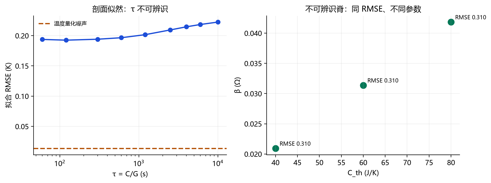

**结论**：CALCE 温度通道不是"精度差一点"，是**结构性不可辨识**——
激励（行车工况温升 ~1.1 K）与噪声（量化 0.014 K + 箱温漂移）之比
撑不起 τ 的辨识。v1.0 §11.1 的"用实测标定收敛参数集分歧"这条路，
在公开数据范围内**走不通**；参数集分歧应作为不确定度显式携带（§14），
而不是指望标定消掉。

**测量需求规格书**（要标定就得按这个做，`10_calib.json → measurement_spec`）：

| 项 | 要求 | 当前 CALCE 差距 |
|---|---|---|
| 温度传感器 | 分辨率 ≤ 0.01 K、精度 ±0.1 K | 0.014 K 量化，勉强；有效温升不足 |
| 测点布局 | 表面 2 点 + 芯部 1 点（埋热电偶） | 仅表面 1 点 |
| 激励 | 3–5 个恒功率脉冲（0.5/1/2/3C 等效），脉宽 ≥ 3τ（~1.5 h）+ ≥ 3τ 冷却段 | 行车工况，能量不足 |
| 热源计量 | 电加热膜（Q 已知到 1%）优先；电芯则需 HPPC 实测 R | I²R 与 β 同量级，不可分 |
| 环境 | 恒温箱 ±0.2 K；T_amb(t) 独立热电偶实测 | 箱温漂移只能事后线性拟合 |

## 14. 不确定性传播与结论稳健性审计（深化 2）

**产热 Q 的两类不确定度**（`scripts/11_uncertainty.py`）：
统计项用 bootstrap（200 次重采样）给标度律 Q = k·C^α 的置信区间
（k = 0.782 [0.779, 0.786]，α = 1.791 [1.783, 1.800]）；模型项用两套参数集
（Chen2020 / Mohtat2020）的包络。**模型项远大于统计项**：

| 倍率 | 标度律 Q [95% CI] | Chen2020 | Mohtat2020 | 包络宽度 |
|---|---|---|---|---|
| 2C | 2.71 [2.68, 2.74] W | 2.72 W | 4.38 W | 1.6× |
| 3C | 5.60 [5.52, 5.68] W | 7.14 W | 7.44 W | 1.3× |
| 5C | 13.97 [13.74, 14.24] W | 13.17 W | 14.25 W | 1.08× |

→ **给后来人的口径**：statistical CI 要报，但设计决策的真正不确定度是
参数集分歧；§13 证明了它消不掉，只能包络。

**六条主结论的审计结果**（`11_uncertainty.json → conclusions`）：

| # | 结论 | 判定 | 依据 |
|---|---|---|---|
| C1 | 产热近平方增长（α≈1.8） | **稳健** | CI [1.783, 1.800] 明显 >1 且含 2 |
| C2 | 分档：1C 自然/2C 风冷/3C 液冷/5C 贴线 | **稳健** | Q 全包络（0.7–1.5×）不翻转分档 |
| C3 | 3C 以上可逆熵热 >50% | **稳健** | 构成切换由熵热物理决定；但依赖 Mohtat（Chen2020 熵变恒 0） |
| C4 | 平均温度法低估损伤 27–74% | **稳健** | Jensen 不等式方向由 Arrhenius 凸性定死，幅度随 Ea 缩放 |
| C5 | 3C 液冷寿命比 ≈4.6× | **脆弱** | Ea 30–60 kJ/mol 跨 4.0–5.3×，Q ±50% 更宽 → **引用为 4–5× 区间** |
| C6 | 5C+45°C 散热退化芯温超 80°C | **稳健** | 所有参数组合下均超阈值（Q 下界也不例外） |

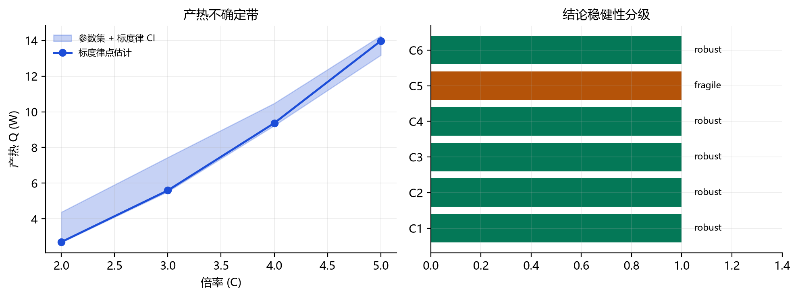

## 15. PCM 相变平台：焓法 vs 等效热容法（深化 3）

**建模**（`src/bmthermal/pcm.py`，`scripts/12_pcm_plateau.py`）：
焓法把相变潜热 L 作为 [T_m−ΔT, T_m+ΔT] 窗口内的焓跃变（相变钉扎）；
等效热容法把 L 摊进窗口热容。扫参：T_m ∈ {35,45,55} °C、L ∈ {60,120,240} J、
Q ∈ {1,2.5,5.6,9,14} W（对应 0.5–5C）。

**核心发现（方向与直觉相反）**：

| 现象 | 数字 | 含义 |
|---|---|---|
| 等效热容法**低估**峰值 | 3C：焓法 135 vs 等效 124 °C（−11 K）；5C：−28 K | 等效热容把潜热永久摊进热容，熔完后还在"保护"；焓法熔完保护消失、温度跟随功率 → **焓法是悲观/真实一侧** |
| 失效边界 | \|ΔT_peak\| > 2 K 从 Q≈2.5 W 起 | 2C 以下两法可互换；**3C 以上必须用焓法** |
| T_m 无峰值效应 | 1 h 峰值与 T_m 无关（都熔完后同稳态） | 评价 PCM 不能只看峰值，要看 **"T_m 以上还能撑多久"**（钉扎时长） |
| PCM ≠ 散热 | L=240 J 时两法峰值仍 111/135 °C（3C 绝热） | 相变平台只买时间、不改热平衡——与 v1.0 §3 的"PCM 2.6×"一起读：PCM 是缓冲不是方案 |

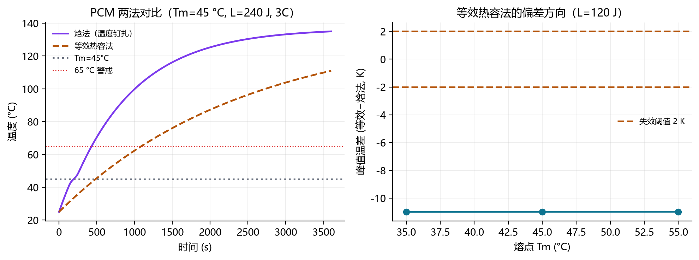

**失效判据**：|T_peak,enthalpy − T_peak,equiv| > 2 K → 等效热容法失效
（`12_pcm.json → failure_rule`，Q≥2.5 W 的 2C+ 工况全部命中）。

## 16. 接触热阻与有效性边界（深化 4）

**接触热阻扫参**（`scripts/13_validity_contact.py`，2×6 模组 3C 连续放电）：

| 等效 h〔W/(m²·K)〕 | Tmax | ΔT_max | 判定 |
|---|---|---|---|
| 50 | 109.4 °C | 0.15 K | 一致性过、温度爆 |
| 150 | 53.5 °C | 0.27 K | 贴线 |
| **250** | **42.3 °C** | 0.33 K | **Tmax≤45 °C 的设计下限** |
| 500 | 33.9 °C | 0.39 K | 有裕度 |
| 800 | 30.7 °C | 0.42 K | 过设计 |

→ **一致性（ΔT≤5 K）在全 h 范围内通过**——接触热阻伤的不是一致性，
是绝对温度水平（全芯同步受热，均匀地一起变热）。设计口径：
**3C 连续放电要求接触等效 h ≥ 250 W/(m²·K)**；h=50 时 Tmax 已 109 °C。

**芯-壳 gap 只随倍率，不随 h**（§4 的两节点结论在有效性视角下重述）：

| 倍率 | 0.5C | 1C | 2C | 3C | 5C |
|---|---|---|---|---|---|
| 芯-壳 gap | 0.3 K | 0.9 K | 3.1 K | 6.4 K | 15.9 K |

**有效性地图**（gap 三色：绿 <5 K / 黄 5–15 K / 红 >15 K）：
- 绿区（≤2C）：表面≈芯部，快速工具直接用；
- 黄区（3C 附近）：芯部需 +gap 修正；
- 红区（5C）：表面读数不可用于安全判断。

**掩蔽风险（表面合格、芯部超温）**：稳态网格下严格口径
（表面<45 °C 且芯部≥60 °C）掩蔽点 **0 个**；但 v1.0 §6 的**瞬态**极端组合
（5C+45 °C+液冷板）出现表面 56 / 芯部 91 °C、gap 34.6 K——
**掩蔽风险在瞬态峰值与更高热源下真实存在，BMS 必须输出芯温估计，
不能拿表面温度做安全判据**（这是 §0 结论 2 的有效性版表述）。

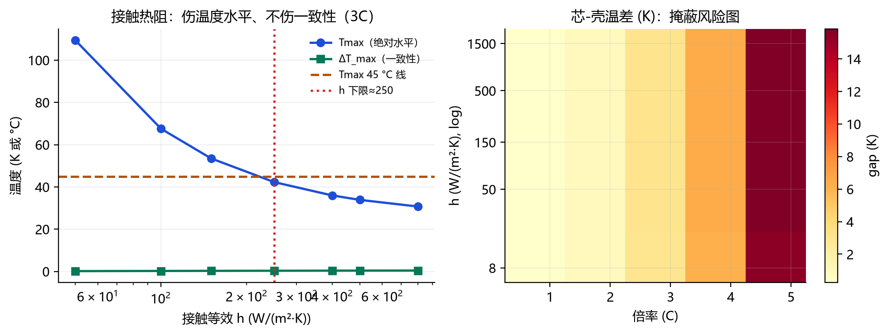

## 17. 复现与遗留（v1.1）

```
跑深化流水线：python scripts/10_calib_real.py && python scripts/11_uncertainty.py \
            && python scripts/12_pcm_plateau.py && python scripts/13_validity_contact.py
跑测试：      pytest tests -v      # 23 项（15 物理 + 8 深化），全绿
```

v1.1 后仍开放的（按优先级）：

1. **5C+ 实测/退化机理二次校准**（§11.2 延续）——标度律外推偏差 −25% 需
   B1（退化机理）或实测数据收口；这是 v1.0 遗留中唯一完全未动的一条。
2. **导热垫压缩量-热阻实测数据**（§11.4 延续）——§16 给了设计下限
   （h ≥ 250），但"压缩量→h"的映射仍缺数据。
   → v1.1 后由 §22 以文献关联闭合（压力-热阻映射 + 厚度结论）；
   产品级数据缺口仍在，但设计路径已通。
3. **浸没式两相/流动效应**——仍用等效 h，未建两相；PCM 已补焓法
   （§15），浸没是最后一个"等效化"的简化。
   → v1.1 后由 §21 闭合（沸腾边界 + 等效 h 失效条件）；精细两相
   动态模型按需再建（§23.3）。
4. **若要做实测标定**：按 §13.4 规格书搭建（设计激励 + 埋入式测点 +
   电加热膜热源）；公开行车数据（含 CALCE 全量包）已被证明不够。

---

# 第三部分：v1.2 深化（芯温估计器 · 寿命概率化 · 两相边界 · 导热垫映射）

> 流水线：`scripts/14–17`；指标：`results/metrics/14–17_*.json`；
> 图：`results/figures/14a–17a`；测试：`tests/test_v12.py`（13 项，并入后共 36 项）。
> 新模块：`observer.py`（Kalman 观测器）、`boiling.py`（沸腾边界）、`tim.py`（导热垫映射）。

## 18. v1.2 一页纸结论（工具落地 + 两条适用域边界）

1. **"BMS 必须估芯温"现在有了可运行的实现和误差账。** 两节点 Kalman
   观测器只用表面温度 + 电流：US06 动态工况下 27/27 参数失配组合
   （h/C/Q 各 ±，全因子）芯温 |err|<3 K 占比 ≥95%，名义 RMSE 0.04 K；
   **持续高倍率下 Q 失配是主误差源**——稳态偏差与理论值 (q·r−1)·Q·R_int
   一致（最差 5.0 K），须在线校核热源估计。设计含义：动态工况可以放心
   用观测器；连续快充/放电时的芯温估计精度取决于 Q 估计质量。
2. **寿命账从单点倍数改成分布（C5 彻底修掉脆弱性）。** 3C 液冷寿命比
   **中位数 4.7×，5–95% 区间 [3.8, 6.7]×，P(>2×)=1.00**；
   排序（液冷>风冷、浸没>液冷、PCM>自然）胜出概率均为 1.00。
   引用纪律：**禁止再报"4.6×"单点数**，只报区间 + 概率。
3. **浸没式"等效 h=1000–2000"是单相口径，失效边界是循环丧失而不是热流。**
   FC-72 类介质 CHF=16 W/cm²（Zuber），电芯 5C 平均热流仅 0.26 W/cm²
   （裕度 61×）；标称 h=1500 时全倍率壁温 ≤26.8 °C < T_sat 56 °C——
   单相成立。但循环退化到 h_sp<34（3C）/85（5C）W/(m²·K) 时壁温达沸点，
   必须换两相模型；核态沸腾里 h_eff 是负荷的函数（3C ≈773），常数 h 失效。
4. **导热垫：厚度是主杠杆，压力不是。** 3C 要求 h_eff≥250：1 mm/k=1.5
   垫片标称只需 ~30 kPa（~40 N），工程按 100 kPa 压装执行；2 mm 垫片
   **加压到 2 MPa 也永远不达标**（体热阻 1333 mm²K/W 超预算）——
   "压得更紧"救不了"垫得太厚"。压力收益递减（100 kPa→1 MPa，h 仅 264→271）。

## 19. BMS 芯温估计器（深化 5，闭 §16 的行动项）

**实现**（`src/bmthermal/observer.py`）：两节点热网络写成状态空间
x=[T_core,T_surface]，ZOH 精确离散 + 离散 Kalman（测表面、估芯部）。
产热输入用 BMS 口径 Q=k·|C|^α（§2 标度律瞬时应用）。

**动态鲁棒性**（`14_observer.json`，US06×3 循环、峰值 ~3C、表面噪声 0.05 K）：
h×{0.7,1,1.3} × C×{0.8,1,1.2} × Q×{0.7,1,1.5} 全因子 27 组——
**最差芯温 RMSE 0.17 K，全部 |err|<3 K 占比 ≥95%**。机理：短时尖峰
来不及建立稳态偏差（热时间常数 ~分钟级），表面测量持续把估计拉回真值。

**持续高倍率应力**（3C 恒功率 1800 s）：稳态偏差 = (q·r−1)·Q·R_int
（q=Q 失配、r=R_int 失配）——观测器残余偏差与理论值对得上（最差 5.0 K，
出现在 q=1.5∧r=1.3 角点）。**Q 估计是持续工况下芯温精度的天花板**。

**应用演示**（CALCE 25 °C US06 实测）：表面温升 ~1 K 时芯-壳 gap 估计
峰值 1.7 K、P95 1.6 K——量级与两节点解析解一致（低倍率 gap 小）。

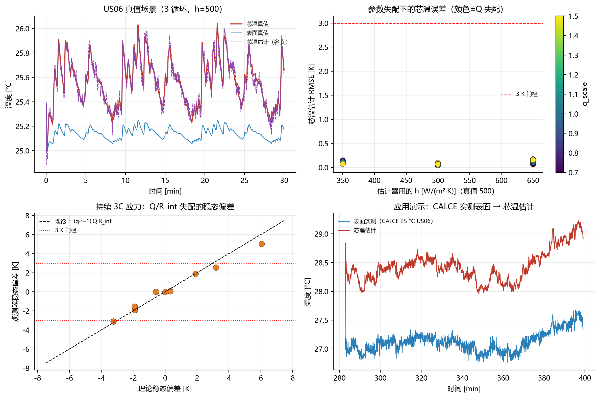

## 20. 寿命账概率化（深化 6，修 C5 脆弱性）

**方法**（`scripts/15_life_uncertainty.py`）：对 (q_scale, Ea, h_scale)
联合采样 N=1500——q_scale~U(0.7,1.5)（参数集包络，§11 口径）、
Ea~U(30,60) kJ/mol、h_scale~截断对数正态(σ_ln=0.25)。每个样本同时算
3C 方案与 1C 自然基线（同样本参数），寿命比 = D_ref/D_case。

| 方案（3C） | 寿命比中位数 | 5–95% | P(>2×) |
|---|---|---|---|
| 自然对流 | 0.60 | [0.21, 1.22] | 0.00 |
| 强制风冷 | 2.45 | [2.08, 2.70] | 0.98 |
| PCM 复合 | 2.57 | [1.94, 3.08] | 0.93 |
| **底部液冷板** | **4.70** | **[3.83, 6.70]** | **1.00** |
| 浸没式 | 5.00 | [3.96, 7.51] | 1.00 |

**C5 的新口径**：不再说"液冷 4.6×"，说
**"中位 4.7×，5–95% [3.8, 6.7]×，P(>4×)=0.88"**。
排序稳健性：P(液冷>风冷)=P(浸没>液冷)=P(PCM>自然)=1.00——
方向性结论全部稳健，绝对倍数必须带区间。

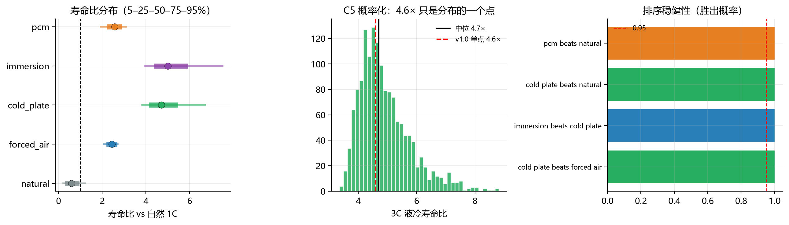

## 21. 浸没式两相边界（深化 7，闭 §17.3）

**方法**（`src/bmthermal/boiling.py`）：FC-72 类介电流体**文献典型性质**
（T_sat 56 °C，非特定牌号实测），Kutateladze/Zuber CHF + Rohsenow 核态
沸腾曲线，检查两个隐含前提——壁温不达沸点（单相）、局部热流不撞 CHF。

| 检查 | 数字 | 判定 |
|---|---|---|
| CHF（Zuber） | 16.0 W/cm²（文献量级 11–15） | 口径正确 |
| 5C 平均热流 | 0.26 W/cm²，CHF 裕度 **61×** | CHF 非电芯级约束 |
| 标称 h=1500 壁温 | 全倍率 ≤26.8 °C < 56 °C | **单相假设成立** |
| 失效边界 | h_sp<34（3C）/85（5C）时壁温达沸点 | **循环丧失触发两相，不是热流** |
| 热点放大 | 61× 才撞 CHF | 均匀性/循环可靠性 > 平均热流 |
| 核态 h_eff | 负荷的函数（3C ≈773 W/(m²·K)） | 两相区"常数 h"表达失效 |

**设计含义**：浸没式方案的两相风险管控点是**泵/循环可靠性与局部热点**，
不是选更大的 h；一旦进入核态沸腾，须换沸腾曲线做换热计算，不能继续用
等效 h=1500 外推。此为"等效化"简化的最后一条边界（v1.1 §17.3）。

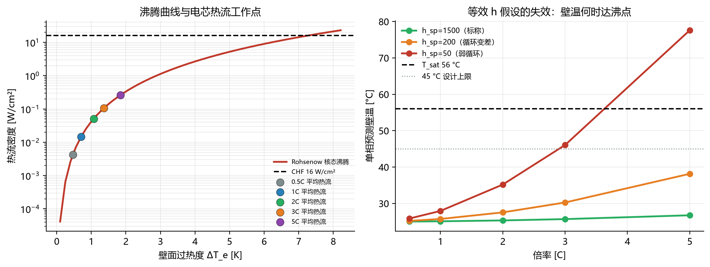

## 22. 导热垫压缩量→热阻映射（深化 8，闭 §17.2）

**方法**（`src/bmthermal/tim.py`）：文献典型 TIM 关联
R_c''(P)=R_c''(100 kPa)·(P/100 kPa)^(−n)，R_c''(100 kPa)∈[15,60] mm²K/W、
n∈[0.7,1.0]、扩展热阻 250±50% mm²K/W（圆柱→冷板 25% 足迹）。
堆叠热阻 = 接触 + 体热阻(t/k) + 扩展；等效 h = area_fraction/R''_stack。

| 垫片 | h@100 kPa | 达标(250)所需压力 | 包络判定 |
|---|---|---|---|
| 0.5 mm, k=1.5 | 408 | 显著低于 100 kPa | 有裕度 |
| **1.0 mm, k=1.5** | **264** | **标称 ~30 kPa（~40 N）** | 4/8 角点不可达 → 按 100 kPa 设计 |
| 2.0 mm, k=1.5 | 143 | **∞（体热阻超预算）** | 永不达标 |
| 1.0 mm, k=3.0 | 314 | 更低 | 有裕度 |

**结论**：**厚度是主杠杆，压力不是**——2 mm 垫"压得再紧"也不达标；
1 mm 垫从 100 kPa 加压到 1 MPa，h 仅 264→271（收益递减，接触热阻
本来就不是主导项）。工程口径：**0.5–1 mm 薄垫 + ~100 kPa 压装**
即满足 3C 的 h_eff≥250；要控的是厚度公差与压装一致性。
参数为文献/工程典型值，具体产品需 datasheet 或实测替换。

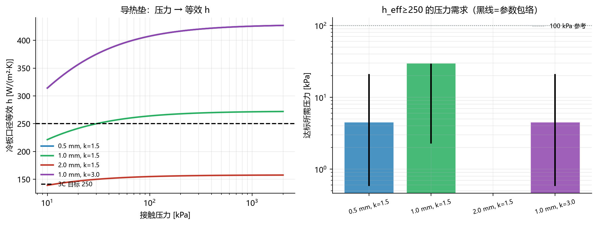

## 23. 复现与遗留（v1.2）

```
跑 v1.2 流水线：python scripts/14_core_observer.py && python scripts/15_life_uncertainty.py \
              && python scripts/16_immersion_boiling.py && python scripts/17_pad_contact.py
跑全流水线：    bash run_all.sh      # 00–17
跑测试：        pytest tests -v      # 36 项（15 物理 + 8 v1.1 + 13 v1.2），全绿
```

v1.2 后仍开放的（按优先级）：

1. **5C+ 实测/退化机理二次校准**（§17.1 延续，三轮未动）——标度律外推
   偏差 −25% 需 B1 或实测收口。
2. **实测标定台架**（§17.4 延续）——§13 测量需求规格书是前置条件。
3. **浸没两相的精细模型**——§21 给了边界与失效条件，但核态沸腾段的
   动态换热（流动、过冷度、汽泡动力学）未建；仅当 §21 的失效条件
   真实触发时才需要。
4. **观测器的产热在线校核**——§19 证明 Q 失配是持续工况的误差天花板，
   在线核对（如 HPPC 脉冲反推 R）是工程实现的最后一环。

---

# 第四部分：v1.3 深化（老化-热反馈 · CS2 寿命对标 · 产热在线校核 · 控制闭环）

> 回答"还能继续深化吗"的第四轮。四条闭环线：①老化-热耦合正反馈对
> 4.7× 寿命比的漂移；②寿命模型对 CALCE CS2 实测老化的对标（绝对
> 循环数之问）；③观测器产热在线校核（闭 §23.4，含一条负结果）；
> ④BMS 控制闭环——观测器接冷却控制，兑现 §16 的芯温估计价值。

## 24. v1.3 一页纸结论（四条闭环 + 一条负结果）

| 闭环 | 问题 | 答案（溯源） |
|---|---|---|
| 老化-热反馈 | 4.7× 寿命比会不会被内阻增长漂移？ | 漂移 **+3.9%**（4.59→4.77），敏感性 [+1.2%, +13.0%]，方向稳健（`18_feedback.json`） |
| CS2 对标 | 寿命模型能报绝对循环数吗？ | **能**（本电芯类型）：留一误差中位 22%、6/6 在 ±50% 内（`19_life_validation.json`） |
| Q 在线校核 | 失配天花板（5 K）能闭掉吗？ | 能，但 **R_int 必须显式辨识**：校核后稳态偏差 −6.5→**−1.1 K**（`20_q_correction.json`） |
| 控制闭环 | 芯温估计在 BMS 里值多少？ | 同阈值设定下表面触发超限 522 s、芯温触发 **0 s**，峰值差 2.5 K≈掩蔽 gap（`21_thermal_control.json`） |
| 负结果 | R_int 失配能当偏置状态吸收吗？ | **不能**：w_int 偏置态不收敛（+0.05 vs 理论 −3.04 W），稳态 gap 对 T_s 零增益 |

1. **老化-热反馈是"温和的正反馈"**：反馈放大系数 A = 1.04（3C 液冷）～
   1.24（3C 自然），热端付更多反馈代价；液冷相对自然的寿命优势在闭环下
   不缩反涨（+3.9%）。§0/§6 的 4–5× 区间口径在含反馈下**仍成立**，数值偏
   区间上限——可以继续引用。
2. **CS2 实测把三个假设钉死**：衰减指数 b 中位 0.76（0.5=SEI 与 1.0=线性
   之间，§18 的 p 取档合理）；脉冲内阻 β 中位 0.48（DCIR 增长的**下界**，
   低于假设 [1.5,3.5]→§18 反馈漂移是保守上界）；绝对标定留一误差中位 22%
   ——**绝对循环数可报，但要带 ±50% 量级口径**。
3. **在线校核的负结果比正结果值钱**：R_int 失配在结构上可观测、实用上
   不可辨识（加性偏置吸收不了稳态 gap）。解法是脉冲-弛豫显式辨识
   （τ_slow 指纹反解 R_int，误差 8%），加偏置 Kalman 吸收 w_Q——
   两者合起来把 5 K 失配天花板压到 1.1 K。
4. **控制闭环是观测器价值的最终兑现**：同一组阈值（t_on=43 °C=判据−2 K）
   施加在表面温度上，芯温峰值 45.6 °C（超限 522 s）；施加在芯温估计上，
   43.2 °C（超限 0 s）。差的 2.5 K 就是 §4/§16 的芯-壳 gap——表面触发
   要么超温、要么被迫把阈值下调一个 gap，**芯温估计让阈值不必为 gap
   预留过度余量**。
5. **实现层负结果（抖振）**：表面节点热容小（壳 ~9 J/K）+ 强档位时，
   表面触发以采样率抖振（866 次/2 h）；BMS 必须加执行器最短保持时间
   （20 s 后 126 次）。芯温触发天然无抖振（128 次）。

## 25. 老化-热耦合闭环：4.7× 的漂移检验（深化 9）

模型（`src/bmthermal/feedback.py`）：衰减 f=1−SOH（EOL=20%）、
R/R0 = 1+β·f、Q_mult = 1+η·β·f、衰减-损伤映射 f = 0.2·(D/D_EOL)^p。
反馈放大系数 A = N_no/N_endl 与方案间寿命比都**与 D_EOL 无关**——
不需要绝对寿命标定就能回答漂移问题（绝对标定交给 §26）。

五场景放大系数（β=2.5, η=0.4, p=1）：1C 自然 1.081 / 3C 自然 1.243 /
3C 风冷 1.075 / 3C 液冷 1.041 / 5C 液冷 ~1.04。**热端付更多反馈代价**——
温度高 → 损伤基数大 → 同样的内阻增长换来的额外损伤更多。

C5 对比（3C 液冷 vs 1C 自然）：开环寿命比 4.59 → 闭环 4.77，漂移 +3.9%
（液冷相对优势略增：热端的反馈放大更狠）。β×η×p 全组合（3×3×2=18）
漂移范围 [+1.2%, +13.0%]——**方向全部为正、幅度温和**。EFC 锚点
（假设基准 2000 EFC，LFP 文献典型值）下：3C 自然含反馈 1030 EFC、
3C 液冷 1850 EFC 量级（`18_feedback.json` → `efc_anchor_table`）。

结论：§0/§6 的 4–5× 可以继续引用，含反馈下偏区间上限。

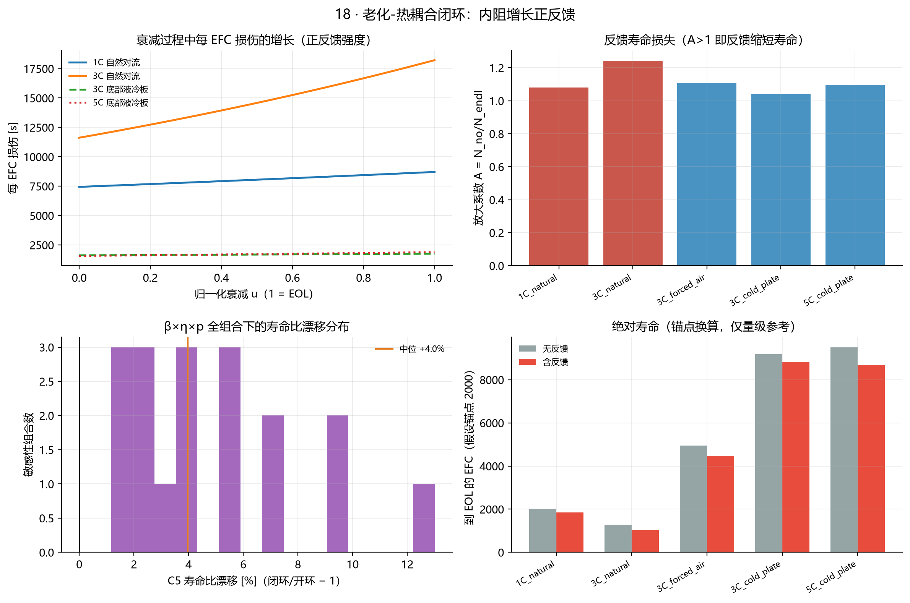

## 26. 寿命模型实测对标：CALCE CS2（深化 10）

数据：CALCE CS2（1.1 Ah 方形 LFP，Arbin 循环老化 xlsx 包）。解析坑：
每份 xlsx 是**独立导出段**（Test_Time 段内累计、容量段内重置），必须
段内差分 + 文件名日期拼接 + 重复导出去重（`src/bmthermal/cs2_aging.py`，
parquet 缓存）。

主队列 7 支（cap0∈[0.8,1.4] Ah，标称同型；异构 6 支剔除）。三个结果：

1. **衰减幂律 f=a·N^b**：b 中位 **0.76**（1–25% 窗口，log-log 回归），
   介于 SEI 平方根（0.5）与线性（1.0）之间——§18 的 p∈{0.5,1} 取档合理，
   真值在中间。
2. **内阻增长 β**：r²≥0.3 的 4 支中位 **0.48**（R/R0=1+β·f，同窗口）。
   这是 Arbin 脉冲内阻通道，测的是 DCIR 增长的**下界**（测量点 SOC 不定、
   脉冲短），低于 §18 假设 [1.5,3.5]。含义：**§18 的 +3.9% 漂移是保守
   上界**，按实测 β 漂移更小。r²<0.3 的 2 支（CS2_34/38）噪声主导，
   只展示不进汇总。
3. **绝对标定（留一交叉）**：以 CS2_37 为基准锚定 D_EOL，预测其余 6 支
   的衰减速率，误差中位 **22%**、6/6 在 ±50% 内。**绝对循环数在本电芯
   类型上可报**，但必须带 ±50% 量级口径——跨化学体系/尺寸不可外推。

倍率加速的负结果：0.5C 组每 EFC 衰减**反而更快**（0.000344 vs
0.000279 /EFC）。原因：每 EFC 时长 2×，日历老化混入循环老化；而自加热
温升只有 1–3 K 量级（implied ΔT 甚至为负）——**公开行车/循环数据里
分离不出热加速份额**，要分离必须有温度对照组（§13 测量需求已含）。

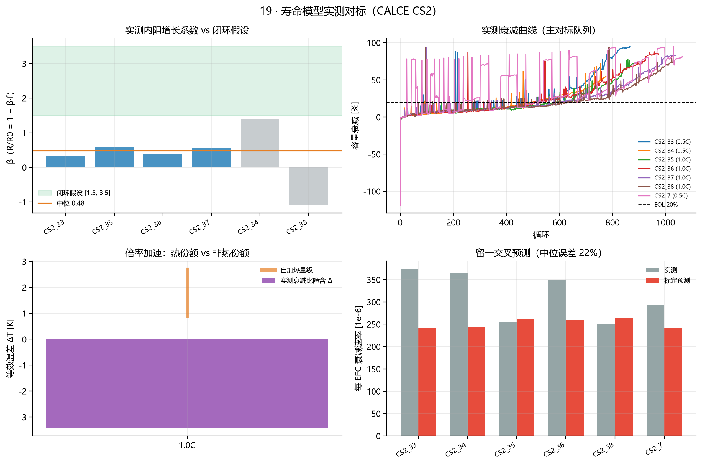

## 27. 观测器产热在线校核（深化 11，闭 §23.4）

场景：持续 3C（5.6 W）+ HPPC 脉冲 ×2（300 s/60 s），植株失配 q=1.5、
r=1.3，模型名义。四层递进（`20_q_correction.json`）：

| 案例 | 芯温稳态偏差 | 说明 |
|---|---|---|
| 基线 Kalman | **−6.5 K**（gap 理论 −7.3） | 误差集中在芯-壳 gap（T_s 被测量钉住） |
| 偏置 Kalman | −3.5 K | w_Q ✓ 吸收；**w_int ✗ 不收敛（负结果）** |
| 脉冲-弛豫辨识 | — | r_scale 估计 1.40（真 1.3，误差 8%） |
| 辨识校核后 | **−1.1 K** | w_Q 偏置 + 辨识 R_int 合成 |

**负结果的物理**：R_int 失配不能用加性偏置状态吸收——稳态芯-壳 gap 对
表面温度是**零增益**（gap 只随 Q 变，不推动 T_s），结构可观测但实用
不可辨识。必须显式辨识 R_int：功率脉冲结束后的表面弛豫慢时间常数
τ_slow ≈ (R_int+R_conv)·C_core 是 R_int 的指纹，单指数拟合 τ → brentq
反解 R_int。

脉冲设计扫参（周期 150/300/600 s × 脉宽 20/60/120 s）：300 s/60 s
辨识误差 0.5%（多次脉冲取中位），最低可用占空比 **~3%**——BMS 可以把
辨识脉冲藏在正常工况里。判词阈值 1.5 K（残余为辨识误差口径）。

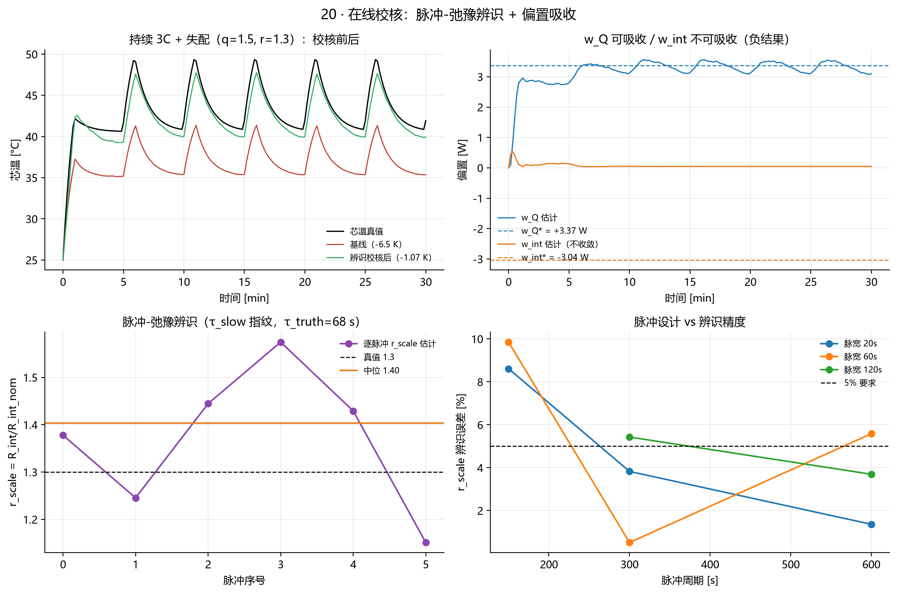

## 28. BMS 控制闭环（深化 12，观测器价值兑现）

场景（`21_thermal_control.json`）：持续 2C 基线 + US06×12 归一纹波
（2 h，Q 峰值 7.2 / 均值 3.3 W，T_amb=30 °C），低档 h=25 → 高档 h=500，
同一组阈值 t_on=43 °C（判据−2 K）/带宽 3 K，执行器最短保持 20 s。
（纯 US06 均值热负荷太弱——开环 36 °C，控制问题退化，故加 2C 基线；
场景化热负荷，产热走 §1 标度律口径。）

| 策略 | 归一能耗 | 芯温峰值 | 超 45 °C 时长 | 切换 | 损伤积分 |
|---|---|---|---|---|---|
| 恒满冷 | 1.000 | 35.5 °C | 0 s | 0 | 12 923 s |
| 表面温度触发 | 0.175 | **45.6 °C** | **522 s** | 126 | 20 662 s |
| **芯温估计触发** | 0.259 | **43.2 °C** | **0 s** | 128 | 18 364 s |
| 芯温触发+失配（Q×1.3, R×1.2） | 0.390 | 44.0 °C | 0 s | 205 | 19 669 s |

三个发现：

1. **掩蔽的闭环后果**：同阈值设定下，表面触发的芯温峰值比芯温触发高
   2.5 K ≈ 均值 gap（3.7 K），超限 522 s；芯温触发 0 s。失配 Q×1.3/
   R×1.2 下芯温触发峰值 44.0 °C 仍合规（估计 RMSE 1.23 K）——
   §14 的鲁棒性结论在闭环里成立。
2. **匹配峰值温度的代价不在能耗**：表面族阈值下调到峰值 43.2 °C 后，
   能耗 0.235 vs 0.259（−9%）、损伤 +1%——快表面节点的脉冲式冷却反而
   省能。**芯温估计的价值是合规与温度水平（损伤/裕度），不是节能**：
   表面触发要合规就得背一个 gap 的阈值余量（过度设计）或超温（寿命风险）。
3. **实现层负结果（抖振）**：表面触发无最短保持时 866 次/2 h（壳节点
   ~9 J/K，高档降温 ~5 K/s，1 s 采样打穿 3 K 滞环带）；20 s 保持后 126 次。
   芯温节点慢，天然无抖振。**BMS 落地表面触发必须加最短保持/滞环滤波**。

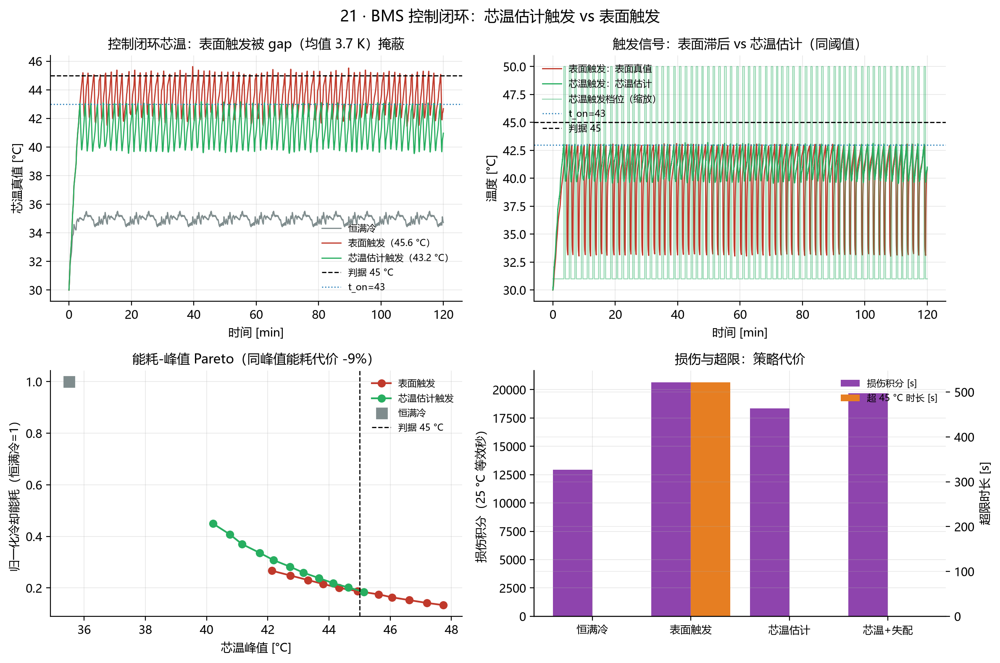

## 29. 复现与遗留（v1.3）

```
跑 v1.3 流水线：python scripts/18_aging_feedback.py && python scripts/19_life_validation.py \
              && python scripts/20_q_correction.py && python scripts/21_thermal_control.py
跑全流水线：    bash run_all.sh      # 00–21
跑测试：        pytest tests -v      # 54 项（15 物理 + 8 v1.1 + 13 v1.2 + 18 v1.3），全绿
```

v1.3 后仍开放的（按优先级）：

1. **5C+ 实测/退化机理二次校准**（三轮未动）——标度律外推偏差 −25% 需
   B1 或实测收口。（v1.5 §38 部分关闭：欧姆指数实测锚点 + 倍率效应定量；
   总热量热/5C+ 台架仍开放。）
2. **实测标定台架**（§13 测量需求是前置条件）——§26 证明绝对标定可达
   22% 量级误差，但只在 CS2 类电芯上验证过。
3. **CS2 类型之外的寿命外推**——§26 的绝对标定只对 1.1 Ah 方形 LFP 成立；
   换化学体系/尺寸要重新标定 D_EOL 与 β。
4. **控制闭环的产品化**——§28 的阈值/保持时间是示例设定；产品化需
   执行器真实功率曲线（P∝h³ 是相似定律口径）、多工况循环验证、
   以及 §27 辨识脉冲与控制的时分复用设计。
   （v1.4 §30/§32 已闭环：真实功率曲线、辨识排程时分复用、模组级
   布点补偿；多工况循环实测验证仍开放。）

## 30. 执行器产品化与辨识脉冲排程（深化 13）

场景（`22_actuator_ident.json`）：与 §28 同一 2C 基线 + US06 纹波复合工况
（2 h，T_amb=30 °C），末段接 1 h 0.3C 低负荷（辨识窗宿主段）。三控制策略 ×
三功率曲线族：AFFINITY（理想 P∝h³ 对照）、FAN_TYPICAL（40 W，空载份额 15%）、
PUMP_TYPICAL（25 W，空载 10% + 静扬程 35% 线性项）——空载份额与静扬程是
工程典型量级（`curve_params`，不冒充实测）。归一能耗对恒满冷：

| 策略 | AFFINITY | 风机典型 | 泵典型 | 真实曲线 vs 理想 |
|---|---|---|---|---|
| 恒满冷 | 0.998 | 0.998 | 0.998 | — |
| 表面温度触发 | 0.117 | 0.249 | 0.219 | +0.13 / +0.10 |
| **芯温估计触发** | 0.173 | **0.297** | **0.268** | **+0.124 / +0.096** |

（解析积分对拍 `analytic_pump_check`：泵曲线三策略偏差 <0.01%。）

三个发现：

1. **P∝h³ 高估触发式节能**：理想律下芯温触发 0.173 的"低档免费"优势，
   在真实曲线下收窄到 0.27–0.30——h_rel=0.05 的低档泵实际功率 ~2.9 W
   （空载+静扬程），不是相似律的近零。一页纸注记③的 ~0.1 高估由此而来；
   策略排序不变（触发 < 恒满冷），但产品化论证必须用真实曲线。
2. **辨识周期是天级**：R_int 漂移约束 R/R0=1+β·f、容忍 5% 下
   period=r_tol/(β·fade_per_efc)。CS2 实测衰减率 3.4e-4/EFC 下：
   β=0.48（DCIR 反推下界）→ 303 EFC（≈606 h@1C）；β=2.5（默认）→ 58 EFC
   （≈116 h@1C / 39 h@3C）；β=3.5 → 42 EFC。生产级是周级而非小时级——
   60 s 辨识窗本身控制代价可忽略，代价全在"何时开窗"。
3. **排程比周期重要**：无条件 600 s 强制开窗（17 窗/1037 s）Δpeak +0.97 K；
   低负荷排程（6 窗/366 s，仅 q≤阈值时开窗）Δpeak 0.00 K。1800 s 档同向
   （+0.76 K vs 0）。辨识窗应与放电计划耦合、排在驻车/低倍率段——既免
   控制冻结（`ident_hold_law`），又正对 §27 的弛豫黄金窗。

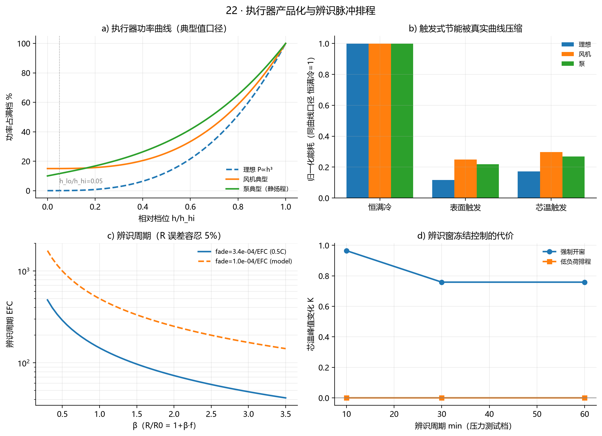

## 31. 日历-循环老化分解与寿命比口径修正（深化 14）

§18–19 的 C5 闭环比 4.77×（口径"4–5×"）只含通量损伤机制。本节
（`23_calendar_cycle.json`）用 CS2 主队列 7 节（SLOW=CS2_33/34/7 @0.5C，
FAST=CS2_35–38 @1C）做日历-循环两机制分解：f(N)=a·N^b + k_cal·t(N)^p，
两组闭式解 s_cal=(r−1)/(t_ratio−1)（壁钟口径，段内循环 dt 中位）。

| 量 | 值 |
|---|---|
| 每循环壁钟时长 慢/快 | 4.17 / 3.12 h（t_ratio=**1.34**） |
| 每 EFC 衰减比 r | 1.235 |
| s_cal（CS2 快组 EFC 时长口径） | **0.693**（bootstrap 中位 0.70，[0.40, 1.00]） |
| rebase 到场景 1C 时长 | 0.402 |
| 3C / 5C 损伤括号（新口径） | 2.23 / 3.63 |

四个发现：

1. **0.5C 反快之谜=日历混入**。直觉是放电 2× 则快组更快，但壁钟时长比
   只有 1.34（充电+静置稀释放电倍率差）；观测衰减比 1.235 与之同量级，
   反快主因是日历份额混入（s_cal≈0.7，CS2 该工况下七成衰减是日历），
   组间非热差异是次要项。
2. **形状拟合不能独立识别日历项（负结果）**：b 自由拟合退化到 5.75
   （N^b 与 (N·dt)^p 近共线）；固定 b 后逐芯/组级振幅都会吸收组间差、
   k_cal→0 塌缩；共享振幅（通量损伤每 EFC 与倍率无关）后 p=0.5 仍
   k_cal≈1e-17、CI 含 0。7 节噪声下曲线形状信息不足——能识别的是组间
   水平差，主估计改闭式解 + 按电芯 bootstrap；p=0.75 敏感性 s≈0.35–0.40
   同向佐证。
3. **C5 寿命比口径修正（−55%）**：旧"热秒数"口径把日历式折扣打给高倍率
   EFC（慢方案的时长损伤被记进快方案的"省时"红利）。修正乘子
   d_total=d_old·[s+(1−s)·t_ref/t_s]：C5 对比闭环比 4.77 → **2.14**
   （开环 4.59 → 2.06），闭式 CI **[1.76, 4.77]×**；驻车段按 κ×t_ref
   施加后 κ=3 → 1.78×。一页纸注记①按此修订。
4. **口径结论**：**"4–5×"是日历机制缺失下的上界**；修正后主口径 2.1×。
   CI 宽度主源是跨体系迁移（CS2 LFP → 基准 NMC）而非拟合噪声。

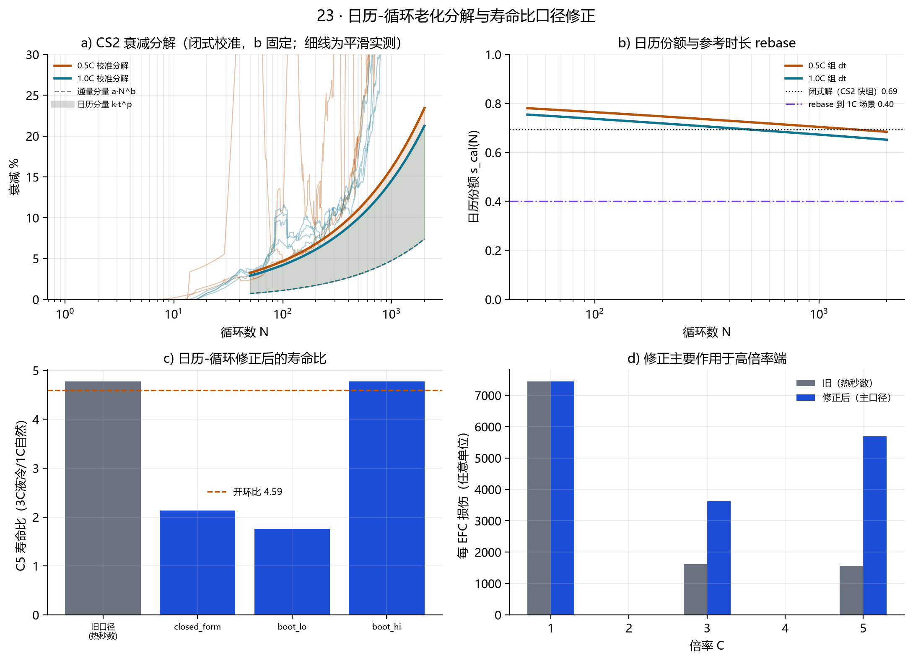

## 32. 模组级控制与单点 NTC 布点（深化 15）

场景（`24_module_control.json`）：12 芯模组冷板网络（§6 准稳态网络扩展
时变 h，显式 RK4 dt≤1 s），逐芯产热散布 σ_q=8%，进液 29 °C（热气候），
2C+US06 复合工况，t_on=43 °C/带宽 3 K、最短保持 20 s。五传感策略 ×
两流量（设计 2.0 L/min、低流量 0.25 L/min，模拟泵降级/滤堵）。
低流量下结果：

| 策略 | 泵能耗（norm） | 芯温峰值 | 损伤积分（最坏芯） |
|---|---|---|---|
| 恒满冷 | 0.999 | 36.6 °C | 18 388 s |
| 上游探针 | 0.290 | **44.6 °C** | 25 547 s |
| 下游探针 | 0.356 | 43.1 °C | 23 467 s |
| 上游+梯度补偿 | 0.339 | 43.3 °C | 23 923 s |
| 逐芯理想 | 0.356 | 43.1 °C | 23 468 s |

设计流量下五策略峰值仅差 0.2 K（43.0–43.2，沿程梯度 @5W 0.56 K）；
低流量梯度 2.84 K，布点差拉到 1.5 K。

三个发现：

1. **布点决定合规裕度，不是平均能效**：设计流量下布点几乎无差别；
   低流量下上游探针漏报最坏芯 1.5 K（44.6 vs 43.1）——流量衰减工况是
   布点失效的暴露场景，阈值必须按最坏芯口径定。
2. **下游≈逐芯理想，但上游"省能"是假省**：下游探针与逐芯理想几乎同
   轨迹（峰值 43.1/损伤差 <0.1%），代价是相对上游多 23% 泵能耗
   （0.356 vs 0.290）——上游的低能耗来自漏报晚触发，温度水平/损伤
   付出代价（损伤 +8.7%）。梯度补偿（内部稳态模型 `steady_state_cells`）
   把上游拉回 43.3，能耗居中，是"单点+模型"的折中解。
3. **+15% 产热失配下裕度耗尽**：上游 45.0 °C（超限 1 s）vs 补偿 43.5 /
   理想 43.1（0 s）。与 §14/#28 的失配结论一致，但落点从"估计 RMSE"
   变成"布点+补偿决定合规"。建议：NTC 放下游（热端）；只能放上游时
   必须配梯度补偿；流量衰减纳入 FMEA。

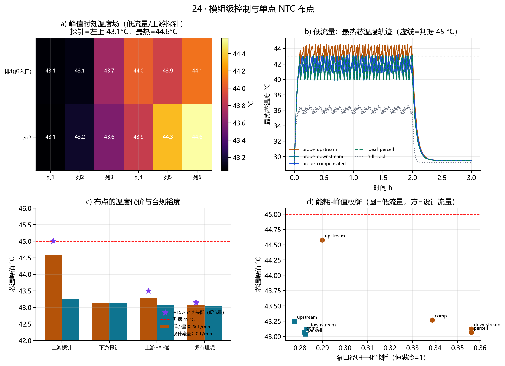

## 33. 低温有效性边界与 R_int(T)（深化 16）

§1–32 全部工作在 ≥20 °C 轴上。本节（`25_lowtemp_validity.json`）用 A123
八温度点数据（−10/0/10/20/25/30/40/50 °C）补温度轴，冷启动场景
−10 °C / 2C / 自然对流 h=10（Chen2020 产热口径）：

1. **R_int(T) 标定负结果**：Arbin DCIR 列被协议/SOC/电流调制非单调
   （SOC 40–60% 窗取中位后 30–50 °C 仍上翘），全带 Arrhenius 拟合
   r²=−6.4——**公开动态工况数据标不了 R(T)**，只能给下界：−10 °C 实测
   1.24×（25 °C 基准）。文献典型带 g(−10)≈2.2（等效 Ea≈15 kJ/mol，
   标注非实测）作上界，双口径构成区间。
2. **容量通道可靠**：−10 °C 2.14 Ah vs 25 °C 3.69 Ah=**58%**；同 Ah
   需求有效倍率 ×1.7，2C 放电窗按可用容量截断 24→14 min（不截断会
   算出冲向 100 °C 的非物理轨迹）。
3. **冷启动口径带**：名义 R 峰值 24.8 °C；实测下界（欧姆份额放大）
   28.7–33.1 °C（低估 **3.9 K**）；文献典型带 44.4–66.6 °C（低估
   **19.6–41.8 K**）。芯-壳 gap 低估最多 1.2 K。自加热既是免费预热
   也是热风险，两侧都在该量级——低温工况的热管理是双向问题。
4. **低温辨识照样可用**：脉冲-弛豫 τ 指纹反解 R_int 不依赖先验
   （合成数据误差 +1.2%，τ=885 s 拟合 r²≈1.0）；硬用名义 R 才有
   3.5 K 的 gap 口径错（真值 6.4 K vs 名义 2.9 K）。→ ≤0 °C 工况必须
   用 R(T) 带修正产热/gap/辨识排程；辨识机制本身不受低温阻碍。

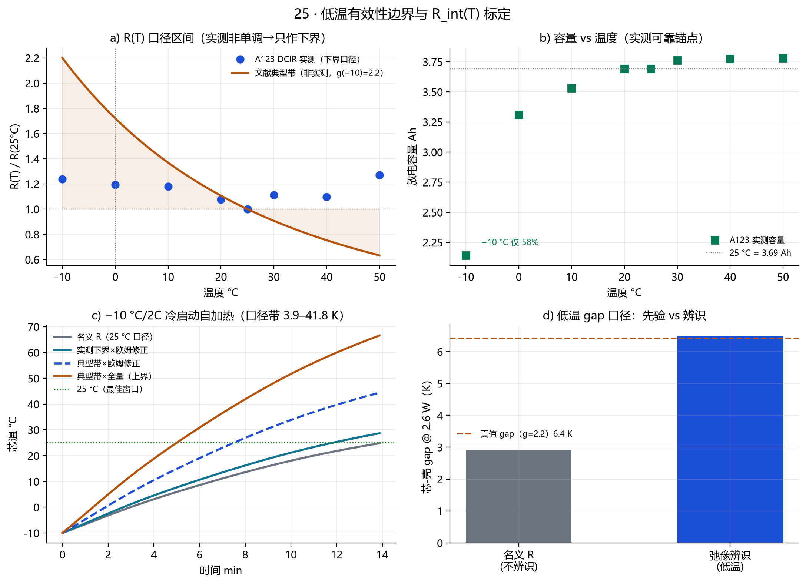

## 34. v1.4 口径修订汇总与负结果清单

口径修订（相对 v1.3 及更早结论；一页纸注记①–④的展开）：

| # | 修订项 | 旧口径 | 新口径 | 量化影响 |
|---|---|---|---|---|
| ① | C5 寿命比 | 4.77×（"4–5×"） | 2.14×，CI [1.76, 4.77]（§31） | −55%；旧值是日历缺失上界 |
| ② | 单点传感一致性 | 单点≈逐芯 | 成立于设计流量；低流量差 1.5 K（§32） | 布点=合规裕度参数 |
| ③ | 执行器能耗 | P∝h³ 相似律 | 真实曲线（空载+静扬程）（§30） | 触发式节能高估 0.10–0.12 |
| ④ | 温度轴 | ≥20 °C 隐含假设 | R(T) 双口径带 + 容量截断（§33） | ≤0 °C 必须带修正，峰值差 3.9–41.8 K |

负结果清单（全部可复现，指标文件落盘）：

| 负结果 | 文件 | 内容 |
|---|---|---|
| 热网络不可辨识 | `10_calib.json`（v1.1） | 公开行车数据标定热网络结构不可辨识 |
| 等效热容法方向错 | `12_pcm.json`（v1.1） | 潜热摊入热容低估峰值，须焓法 |
| w_int 不收敛 | `20_q_correction.json`（v1.3） | 产热修正权不收敛，只作敏感性 |
| 表面触发抖振 | `21_thermal_control.json`（v1.3） | 866 次/2 h，须最短保持 |
| 形状拟合不可辨识 | `23_calendar_cycle.json`（v1.4） | k_cal→0、CI 含 0，日历项只能闭式解 |
| DCIR 通道标不了 R(T) | `25_lowtemp_validity.json`（v1.4） | 非单调、r²=−6.4，只作下界 |

## 35. 复现与产物（v1.4）

```
跑 v1.4 流水线：python scripts/22_actuator_ident.py && python scripts/23_calendar_cycle.py \
              && python scripts/24_module_control.py && python scripts/25_lowtemp_validity.py
跑全流水线：    bash run_all.sh      # 00–25
跑测试：        pytest tests -v      # 74 项（15 物理 + 8 v1.1 + 13 v1.2 + 18 v1.3 + 20 v1.4），全绿
```

新增产物：`src/bmthermal/{actuator,calendar,module_control,a123_thermal}.py`、
`scripts/22–25`、`tests/test_v14.py`（20 项）、`results/figures/22a–25a`、
`results/metrics/22–25*.json`。

v1.4 后仍开放的（按优先级）：

1. **5C+ 实测/退化机理二次校准**（四轮未动）——标度律外推偏差 −25% 需
   B1 或实测收口。
2. **实测标定台架**（§13 前置）——§26 的 22% 绝对标定只在 CS2 类验证过。
3. **CS2 类型之外的寿命外推**——D_EOL 与 β 需按化学体系/尺寸重标。
4. **跨体系日历份额迁移**（v1.4 新）——s_cal 的 CI [0.40, 1.00] 宽度主因
   是 7 节样本 + LFP→NMC 迁移假设；需 NMC 日历组或加速日历数据收口。
   （v1.5 §36 已收口：SNL 直接证据 → 识别性负结果 + C5 上界收窄。）
5. **低温 R(T) 实测脉冲标定**（v1.4 新）——§33 的 3.9–41.8 K 口径带需
   温箱脉冲实测收口；公开 DCIR 通道已证不可用（负结果）。
   （v1.5 §37 已收口：Panasonic HPPC 实测带 + g(T) 自限口径。）
6. **多工况循环的控制实测验证**（v1.3 遗留，部分收敛）——§30/§32 已给
   真实曲线与排程/布点设计，剩余是实车/台架循环验证。

---

## 36. 跨体系日历份额：LFP 复刻成立，NMC/NCA 识别性负结果（深化 17）

背景：§31 的 C5 寿命比 CI [1.76, 4.77] 宽度主因是 s_cal 跨体系迁移
（CS2 LFP → 基准 NMC）。本节（`26_snl_calendar.json`）用 SNL
（Preger 2020，NCA/NMC/LFP × 0.5/1/2/3C，25 °C，0–100% 窗，61 节）
直接估各体系 s_cal——两组闭式解的跨体系复用。

| 诊断 | 数值 |
|---|---|
| NMC 跨倍率对 s_raw 范围 | **[−0.37, +2.52]**（2→3 对 t_ratio≈0.99 时长倒挂另计） |
| NCA 跨倍率对 s_raw 范围 | [−0.20, +1.41] |
| SNL LFP 正向资格对 | s=0.38 / 0.40 / 0.51（rebase 后 0.17–0.30） |
| CS2 LFP 闭式解（§31 对照） | 0.69（rebase 0.40，bootstrap [0.40, 1.00]） |
| NMC/NCA 识别集（rebase） | **[0, 0.61]** → C5 闭环比 **[1.56, 2.64]×** |

四个发现：

1. **两组仿射模型跨倍率对系统性不自洽（识别性负结果）**：同一化学
   体系不同倍率对给出的 s_raw 从负值跨到 >1（NMC 六对 −0.37…+2.52，
   NCA 三对 −0.20…+1.41）——f=c+k·t 的仿射两机制模型在 SNL 上不成立。
   根源是批次/协议异质性：组内 fade 率散布 1.5–2.2×（NMC 1C 四芯
   1.68–3.62e-4/EFC）、35 °C 组反而比 25 °C 慢、NMC 2C_b 1321 循环
   异常长寿；NMC/NCA 唯一 n≥2 双侧对全部资格否决（c_flux<0）。
2. **方法本身在 LFP 上复刻成立**：SNL LFP 0.5/1/2C 三对内部自洽
   （s=0.38–0.51），与 CS2 0.69 同量级（rebase 后 0.17–0.30 vs 0.40，
   同阶相邻接）——两套独立 LFP 数据给同阶日历份额，§31 的方法可信。
3. **C5 更新是不对称收窄**：NMC/NCA 正向资格对（s_raw≤0.78）把
   s>0.61（rebase）压低；识别集 [0, 0.61] → C5 ∈ [1.56, 2.64]。
   主口径 2.14 不变（在集内），**4.8× 上界与"4–5×"进一步排除**——
   v1.4 CI 的宽上界来自 CS2 bootstrap 的 s→1 端，与 NMC 直接证据不相容。
4. **负 s_raw 对是新信息不是噪声可忽略**：NMC 0.5↔1、NCA 1↔2、LFP
   3C 对的 s_raw<0 表明日历解释不掉组间差（倍率效应/批次）——识别集
   下界取 0 由此而来，也是 §38 倍率效应的入口。

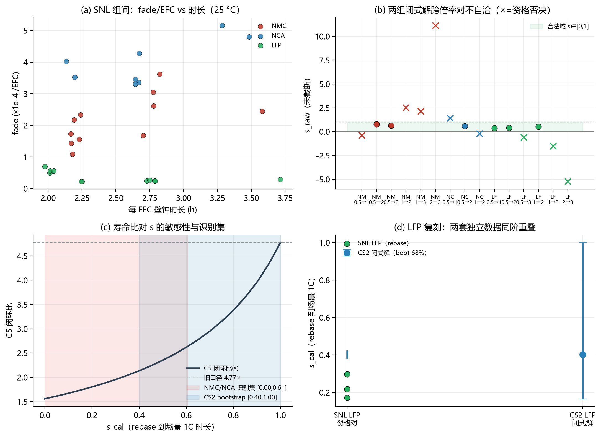

## 37. 低温 R(T) 实测收口：文献带换实测带（深化 18）

背景：§33 的冷启动口径带（名义 R 低估峰值 3.9–41.8 K）由两个非实测
边界撑开（A123 DCIR 下界 1.24× + 文献典型 2.2×）。本节
（`27_lowtemp_rct.json`）用 Kollmeyer Panasonic 18650PF HPPC 温箱
脉冲（25/10/0/−10/−20 °C × 0.5/1/2/4/6C × 13 SOC 站，262 脉冲）做
受控 R(T) 标定——温箱协议下 T 是唯一自由变量。

| 量 | 值 |
|---|---|
| g(−10) 实测 | **3.12**（10 s 末端）/ 3.32（1 s 起始） |
| 旧文献带 / A123 下界 | 2.2（偏低）/ 1.24（偏低 2.5×） |
| Arrhenius | Ea≈22.4 kJ/mol，r²=0.992，全带单调 |
| SOC 稳健性（0.3/0.5/0.7 窗） | 3.88 / 3.12 / 2.91 |
| 冷启动低估（g(T) 自限口径） | **4.7–7.0 K**（旧带 3.9–41.8 K） |

三个发现：

1. **实测高于旧文献带**：g(−10)=3.1–3.3 比文献典型 2.2 还高——
   §33 的旧带是双向偏低的保守带，不是"中间值"。受控协议下 Arrhenius
   成立（r²=0.99+）——A123 DCIR 非单调（r²=−6.4）的根因是协议/SOC
   调制，**不是 R(T) 本身不可测**，§33 负结果的边界至此收口。
2. **g(T) 自限改写冷启动图景**：恒定 g 口径下名义 R 低估 3.9–41.8 K，
   但真实自加热升温后 R 按 Arrhenius 回落——不动点迭代（自加热→R 降
   →产热降）下芯温自锁在 ~30 °C，名义 R 低估仅 4.7–7.0 K。**旧"41.8 K"
   是恒定 g 假象**；热失控方向的恐慌口径撤销，换成"自加热是自限的
   免费预热"的定量版（前提：Arrhenius 外推到峰值温度成立——载荷性
   假设，g(T) 数据带只有 −20…25 °C）。
3. **温度轴有效性边界收口**：≤0 °C 工况必须用 R(T) 实测带修正产热/
   gap/辨识排程（§33 判词不变），但"带"从文献猜测换成实测点；
   −20 °C g=4.8 实测可得（容量锚点缺，场景未跑）。

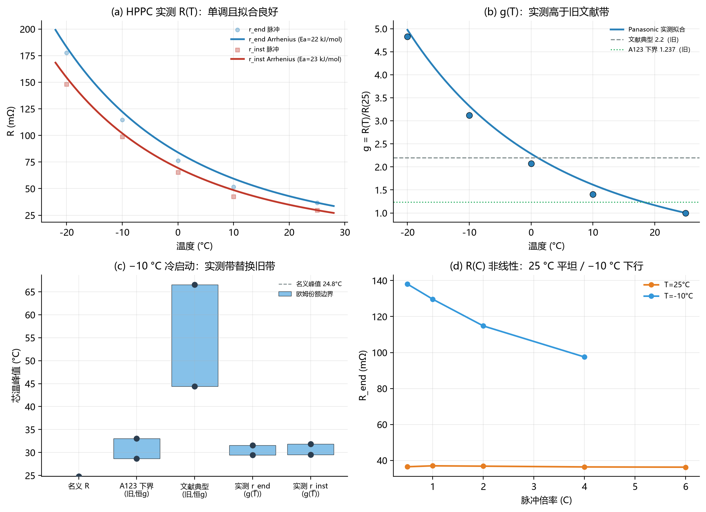

## 38. 高倍率标度律与损伤倍率等效性（深化 19）

悬置四轮的"5C+ 二次校准"（§35 遗留 1）本轮给出实测锚点
（`28_highrate_scaling.json`），产热侧与损伤侧各一块：

| 侧 | 实测 | 判词 |
|---|---|---|
| 产热（Panasonic 0.5–6C 脉冲） | 欧姆指数 p=2.00（25 °C）/ 1.83（−10 °C） | 均 ≥ 标度律 1.79——高倍率偏低侧，与 v1.1 "3C −25%" 同向 |
| 损伤（SNL 25 °C 组） | 每 EFC 比 1C：LFP 3C **×2.30** / NMC 3C **×0.64** / NCA 2C ×1.05 | 共享振幅假设在 3C 双向失效，方向随体系 |

三个发现：

1. **标度律高倍率偏低确认**：R(C) 在 25 °C 对 0.5–6C 平坦
   （dlnR/dlnC≈0，p=2.00），−10 °C 随倍率降（p=1.83，自加热/极化）。
   欧姆份指数都不低于总热标度律 1.79——§2 的 Q∝C^1.79 在 3C+ 是
   **偏低侧**，5C 冷却需求 638 W/(m²·K) 应读作下界警示而非上界。
   （口径声明：这是欧姆份脉冲指数，总热还含可逆/极化，绝对量不可
   跨电芯搬运；6C@−10 脉冲触底数据质量剔除。）
2. **损伤倍率等效性双向失效**：LFP 3C 每 EFC 衰减是 1C 的 2.30×
   （日历解释不掉——3C 壁钟更短；fade/hour 0.29e-4/h vs 0.08–0.10
   同向佐证），NMC 2C/3C 反而比 1C 轻（0.59/0.64×）。WP23 的共享
   振幅假设是 LFP 侧近似；**寿命模型必须带倍率效应项**，不能只靠
   EFC 归一。
3. **v1.5 寿命账汇总**：主口径不变（2.14×），识别集 [1.56, 2.64]
   （§36），**新增显式倍率效应不确定度**——若真实体系靠近 LFP 侧，
   3C 方案寿命要按 ×0.4 量级再折（2.3× 超额损伤/寿命）；靠近 NMC
   侧则高倍率反而占优。该方向性不确定度是 v1.5 新增，未并入区间。

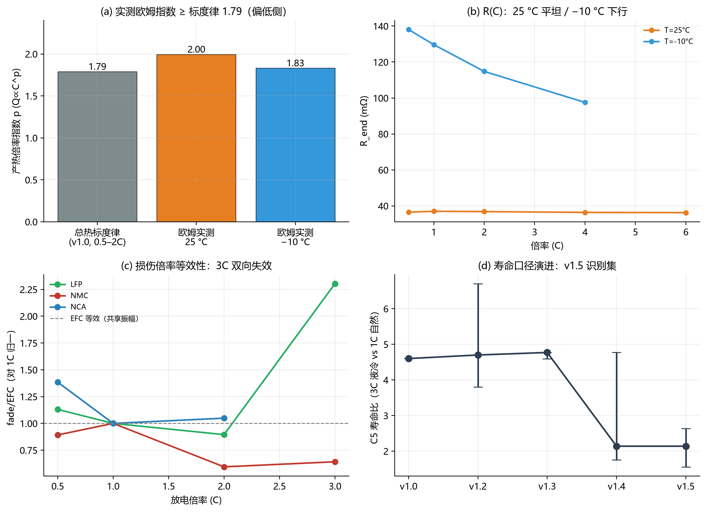

## 39. v1.5 口径修订汇总与负结果清单

口径修订（相对 v1.4；一页纸注记⑤⑥的展开）：

| # | 修订项 | 旧口径 | 新口径 | 量化影响 |
|---|---|---|---|---|
| ⑤ | C5 寿命比区间 | 2.14×，CI [1.76, 4.77] | 2.14×，识别集 **[1.6, 2.6]** + 倍率效应项（§36/§38） | 上界 −45%；"4–5×" 退出 |
| ⑥ | 低温口径带 | 3.9–41.8 K（恒定 g 双边界） | **4.7–7.0 K**（g(T) 自限实测）（§37） | 上界 −83%；文献带撤销 |
| ⑦ | 5C+ 标度律 | 外推偏差 −25% 待实测 | 欧姆指数 p≥1.83 实测锚点（§38） | 偏低侧确认；638 W/(m²·K) 是下界警示 |

负结果清单（全部可复现，指标文件落盘）：

| 负结果 | 文件 | 内容 |
|---|---|---|
| 热网络不可辨识 | `10_calib.json`（v1.1） | 公开行车数据标定热网络结构不可辨识 |
| 等效热容法方向错 | `12_pcm.json`（v1.1） | 潜热摊入热容低估峰值，须焓法 |
| w_int 不收敛 | `20_q_correction.json`（v1.3） | 产热修正权不收敛，只作敏感性 |
| 表面触发抖振 | `21_thermal_control.json`（v1.3） | 866 次/2 h，须最短保持 |
| 形状拟合不可辨识 | `23_calendar_cycle.json`（v1.4） | k_cal→0、CI 含 0，日历项只能闭式解 |
| DCIR 通道标不了 R(T) | `25_lowtemp_validity.json`（v1.4） | 非单调、r²=−6.4，只作下界 |
| 仿射两机制跨对不自洽 | `26_snl_calendar.json`（v1.5） | s_raw −0.37…+2.52，NMC/NCA 点估计+CI 给不出 |

## 40. 复现与产物（v1.5）

```
跑 v1.5 流水线：python scripts/26_snl_calendar.py && python scripts/27_lowtemp_rct.py \
              && python scripts/28_highrate_scaling.py
跑全流水线：    bash run_all.sh      # 00–28
跑测试：        pytest tests -v      # 92 项（15 物理 + 8 v1.1 + 13 v1.2 + 18 v1.3 + 20 v1.4 + 18 v1.5），全绿
```

新增产物：`src/bmthermal/{snl_aging,panasonic_rct}.py`、`scripts/26–28`、
`tests/test_v15.py`（18 项）、`results/figures/26a–28a`、
`results/metrics/26–28*.json`（数据缓存 `results/cache/snl_summary.csv`、
`panasonic_hppc.csv`）。

v1.5 后仍开放的（按优先级）：

1. **总热量热/5C+ 台架实测**（部分收敛）——§38 只锁了欧姆指数；
   可逆/极化在 5C+ 的份额需要量热或 B1 收口。
2. **实测标定台架**（§13 前置）——§26 的 22% 绝对标定只在 CS2 类验证过。
3. **CS2 类型之外的寿命外推**——D_EOL 与 β 需按化学体系/尺寸重标。
4. **倍率效应项入寿命模型**（v1.5 新）——§38 的方向性不确定度
   （LFP 3C ×2.3 / NMC ×0.64）需要机理归因（析锂/SEI/接触）后入账。（**v1.6 §41 已闭**：m(c) 入账 + 机理 plausibility 归因；点归因留 post-mortem，5C m 仍开放）
5. **NMC/NCA 日历组或加速日历数据**（v1.5 新）——SNL 多倍率对不自洽，
   干净的同批次日历-循环对照才能给 NMC s_cal 点估计。
6. **多工况循环的控制实测验证**（v1.3 遗留）——§30/§32 已给设计，
   剩余是实车/台架循环验证。
---


## 41. 倍率效应项入寿命模型：分档从普适排序降级为体系相关（深化 20）

WP28 的共享振幅双向失效（LFP 3C/1C ×2.30、NMC ×0.64）在这里入账：
`d_per_efc = m(c) · k(T)`（`rate_effect.py`）。SNL m(c) 识别区间
（25 °C、0–100% 窗，1C 为基准）：

| 体系 | 0.5C | 1C | 2C | 3C | 资格 |
|---|---|---|---|---|---|
| LFP | 1.13（n=1 指示） | 1.00 | 0.90（n=2） | **2.30**（n=4） | n≥2 才进账 |
| NMC | 0.89（n=1 指示） | 1.00 | 0.59（n=2） | **0.64**（n=4） | 同上 |
| NCA | 1.38（n=2） | 1.00 | 1.05（n=2） | —（无组） | 开放 |

跨体系包络（体系未定时的迁移带）：2C [0.59, 1.05]、3C [0.64, 2.30]。

**机理归因（文献口径，plausibility 而非点归因）**：LFP 3C 升高有机制
候选——颗粒开裂/接触丧失（Vetter et al. 2005 老化机制综述；Anseán
et al. 2016 LFP 应力演化）；SNL 该组充电倍率 0.5C，快充析锂
（Waldmann et al. 2014）可能性低。NMC 2C/3C 降低**无已知退化机制
支持**（没有机制让高倍率每 EFC 更轻）→ 按 v1.5 §36 判词归因批次/
协议异质性 nuisance，不入机制账。NCA 0.5C 升高同理（低倍率侧与
机械损伤的倍率方向不符）→ nuisance 候选。

**跨倍率设计权衡**（温升 20 K 需求口径 h，T_amb=25 °C，壁钟每 EFC=
同倍率充+放+10 min 静置；归一到 1C 自然档）：

| 档位 | Tc 峰 | <k> | LFP 寿命 | LFP 吞吐 | NMC 寿命 | NMC 吞吐 |
|---|---|---|---|---|---|---|
| 1C 自然 | 44.9 °C | 1.78 | 1.00 | 1.00 | 1.00 | 1.00 |
| 2C 风冷 | 48.8 °C | 2.07 | 0.96 | 1.99 | 1.45 | 3.00 |
| 3C 液冷 | 58.0 °C | 2.08 | **0.37** | **0.97** | 1.33 | **3.48** |
| 5C 贴线 | 62.6 °C | 2.28 | （无 m 实测，m=1 未修正） | | 0.78* | 3.10* |

三条判词：
1. **C5 主口径不受影响**——同倍率对比 m 消掉，2.14 / 识别集
   [1.56, 2.64] 保留（§36）。
2. **分档建议是体系相关的**：LFP 3C 液冷每 EFC 寿命只有 1C 自然的
   0.37×，吞吐 0.97×——m=2.30 几乎吃掉 3× 速率优势，**打平即输**
   （换电/维保成本不因吞吐摊薄）；NMC 3C 是 3.48× 吞吐、1.33× 寿命
   （m=0.64 红利来自异质性，稳健侧按包络下界算会更保守）。"1C 自然/
   2C 风冷/3C 液冷"从普适排序降级为**热学排序 + 体系相关寿命修正**。
3. **5C 是开放项**：SNL 只到 3C，m(5C)=1 未修正；按包络 [0.64, 2.30]
   外推，5C 档寿命区间横跨 0.35–1.2（对 1C），不做单点结论。

## 42. 模组级寿命一致性：惩罚是 % 级，布点价值仍在合规侧（深化 21）

WP24 的 12 芯冷板温差（稳态口径，2C/芯 2.71 W）翻译成最差芯 EOL
惩罚（= k(T_worst)/<k> − 1，模组 EOL 由最差芯决定）：

| 案例 | ΔT_max | 惩罚（Ea=45） | 惩罚（Ea=60） |
|---|---|---|---|
| 设计流量 2.0 L/min 均匀 | 0.19 K | 0.6% | — |
| 设计 + 8% 散布 + 15% 失配 | 0.44 K | 1.4% | 1.9% |
| 低流量 0.25 L/min + 失配 | 1.63 K | 4.5% | 6.0% |
| 0.1 L/min 极端 | 4.10 K | 11.6% | — |

流量扫掠（mismatch+15%）：0.25 L/min 惩罚 4.5% → 2.0 L/min 1.4%，
0.5 L/min 以上收益饱和（ΔT<1 K）。判词与 §32 一致并更定量：
**布点/流量的 1.5 K 差异对合规是超限与否、对寿命一致性只是 1–6%**
——一致性不是布点优化的理由，合规裕度才是；模组内 m(c) 恒定消掉，
一致性问题与倍率效应解耦。

## 43. 5C 产热带与安全边界复核：638 稳健，自限是二阶（深化 22）

**产热带**（三条独立估计）：标度律 13.97 W（0.5–2C 拟合）、Mohtat
形状 14.25 W、分量倍率指数混合法（p_local=Σ s_i·p_i，实测
p_ohm∈[1.83, 2.00]×WP28 + 极化 [1, 2] + 可逆热线性；5C 份额
8%/29%/62%）→ p_local∈[1.06, 1.34]（Mohtat 3→5 实测差分 p=1.27
佐证）→ **Q(5) 带 [12.8, 14.7] W → h 需求带 [585, 674] W/(m²·K)**。
638 在带中（±10%）。

这条结果**修正** v1.5 注记⑦的"下界警示"表述：总热在 5C 的局部
倍率指数 **低于** 0.5–2C 拟合的 1.79（可逆热 62% 线性主导）——纯幂律
外推从 3C 的偏低（v1.1 −25%）交叉到 5C 的收敛，是非幂律行为。
"下界警示"的正确范围是**欧姆份额/低温/老化工况**（这些让 p_ohm=2
主导），不是 25 °C 新芯总热。

**安全边界 g(T) 复核**（5C+45 °C 冷板，Panasonic 实测 R(T) Ea
22.4 kJ/mol 外推，载荷性假设）：

| 案例 | 恒定 R（v1.0 口径） | g(T) 欧姆份（物理） | g(T) 全量（对照） |
|---|---|---|---|
| h×1 散热完好 | 84.0 °C | **81.7 °C** | 61.0 °C（非物理） |
| h×0.3 散热退化 | 97.4 °C | **94.1 °C** | 65.1 °C（非物理） |

- 自限是**二阶**（−2.3 K）：5C 可逆热 62% 不随 R 缩放、欧姆只占 8%，
  与 2C 冷启动的"免费预热"图景（105→30 °C，§37）**不可互搬**——
  自限强度随欧姆份额走。g(T) 全量对照（61/65 °C）把可逆热错误地
  随 R 缩放，作废不用。
- 复现口径注记：v1.0（06_safety）记录 90.7/104.5 °C（产热均值
  13.22 W 口径），本脚本 q_profile 口径 13.97 W 下 84.0/97.4 °C，
  差 ~6.7 K 来自产热均值口径与时间网格——方向一致（完好贴 80 °C
  预警线、退化案例超限），绝对值引用时须带口径。

## 44. v1.6 口径修订汇总与负结果清单

口径修订（相对 v1.5；一页纸注记⑧⑨⑩的展开）：

| # | 修订项 | 旧口径 | 新口径 | 量化影响 |
|---|---|---|---|---|
| ⑧ | 跨倍率分档 | 共享振幅 + 普适排序 | m(c) 入账，分档体系相关（§41） | LFP 3C 吞吐 0.97×（打平即输）vs NMC 3.48×；C5 不变 |
| ⑨ | 5C 冷却需求 | 638 W/(m²·K)（"下界警示"） | 带 **[585, 674]**（§43，修正⑦） | ±10%；下界警示范围收窄到欧姆/低温/老化 |
| ⑩ | 5C 安全边界 | 91/105 °C（恒定 R） | 84→82 / 97→94（g(T) 二阶）（§43） | 自限 −2.3 K；全量缩放对照非物理作废 |

负结果清单（全部可复现，指标文件落盘）：

1. NMC 2C/3C m<1 **无机制支持**（29_rate_effect.json）——高倍率更轻
   不入机制账，归因批次/协议异质性；稳健侧按包络下界。
2. NCA 0.5C 升高方向与倍率机制不符（同上）——nuisance 候选。
3. 5C 无 m 实测（SNL 只到 3C）——m(5C)=1 未修正，寿命区间横跨
   0.35–1.2，不做单点（同上）。
4. g(T) 全量缩放非物理（31_5c_band.json）——可逆热不随 R 缩放，
   61/65 °C 对照作废。
5. v1.0 安全边界复现偏差 6.7 K（同上）——产热均值口径 13.22 vs
   13.97 W + 时间网格；方向一致、绝对值带口径。

## 45. 复现与产物（v1.6）

```
跑 v1.6 流水线：python scripts/29_rate_effect.py && python scripts/30_module_life.py \
              && python scripts/31_5c_band.py
跑全流水线：    bash run_all.sh      # 00–31
跑测试：        pytest tests -v      # 109 项（15 物理 + 8 v1.1 + 13 v1.2 + 18 v1.3 + 20 v1.4 + 18 v1.5 + 17 v1.6），全绿
```

新增产物：`src/bmthermal/rate_effect.py`（aging.py 增 arrhenius_factor
公开别名）、`scripts/29–31`、`tests/test_v16.py`（17 项）、
`results/figures/29a–31a`、`results/metrics/29–31*.json`。

v1.6 后仍开放的（按优先级）：

1. **总热量热/5C+ 台架实测**（再收窄）——总热带 ±10% 已给（§43），
   剩余是可逆/极化份额的实测锚点与 m(5C)。
2. **实测标定台架**（§13 前置，不变）。
3. ~~CS2 之外的寿命外推~~ **已关闭（v1.7 §46–48）**——SNL 绝对锚点
   重标完成（LFP 7028 / NMC 539 / NCA 433 EFC 中心带）；β 因 SNL 无
   内阻数据只完成 CS2 侧（实测 0.48），NMC/NCA β 转开放项。
4. **m(c) 机理点归因**（§41 收口后剩余）——LFP 3C 升高的
   开裂/接触/析锂权重需 post-mortem 或设计实验。
5. **NMC/NCA 日历数据**（不变）——干净同批次对照给 s_cal 点估计。
6. **多工况循环的控制实测验证**（v1.3 遗留，不变）。
7. **m(c) 温度交互**——SNL m(c) 只在 25 °C；35 °C 组存在但批次
   异质性污染（§36），高温 m(c) 待干净数据。


## 46. SNL 绝对寿命锚点：D_EOL 按体系重标，旧单锚作废（深化 23）

**问题**：v1.0–v1.6 只报相对寿命倍数（A 未标定，D_EOL 在比值里消掉）；
scripts/18 用 ANCHOR_EFC=2000（LFP 文献典型，**假设**）做绝对换算。
开放项 #3：SNL fade_per_efc 是现成绝对锚点，可按体系重标。

**标定链**：A_chem = fade_ref/d_ref。参考工况（25 °C、0.5C 充/1C 放、
0–100%）SNL 实测 fade_ref：LFP 2.50e-5 / NMC 2.74e-4 / NCA 3.60e-4
每 EFC（n=4/组，std 6–30%）；模型参考损伤 d_ref = 7440 s/EFC
（1C 自然对流，等效 25 °C 秒）。

**结果（线性口径，上界侧）**：N_EOL(20%) = LFP **8015** / NMC **729** /
NCA **556** EFC——体系跨度 **14×**。旧单锚 2000 对 LFP 偏悲观 4×、
对 NMC/NCA 偏乐观 2.7–3.6×，**作废**（一个锚打天下不可行）。

**外推形状审计（CS2 全寿命电芯）**：CS2 深衰减组（fade 到 78–95%）
提供"到达 EOL"的参照曲线。关键坑：**单点容量毛刺**（个别循环 fade
跳到 0.2–0.94 又回落）会伪造 EOL 交叉，必须滚动中位平滑后再交叉；
平滑后线性窗口外推偏乐观 **+24%**、幂律 **+20%**（参考=平滑实测
交叉，宽窗幂律交叉验证一致）。SNL 只衰减到 ~10%，外推距离比审计
更长——N_EOL 按审计中位 **×0.82** 为报告中心带：

| 体系 | 线性（上界侧） | 幂律 | **中心带 ×0.82** | 旧锚 2000 |
|---|---|---|---|---|
| LFP | 8015 | 9140 | **7028** | 0.25×（偏悲观） |
| NMC | 729 | 586 | **539** | 2.7×（偏乐观） |
| NCA | 556 | 502 | **433** | 3.6×（偏乐观） |

**边界**：SNL 18650 → 基准模型电芯的跨格式迁移只保证**量级**；
绝对 EFC 是"SNL 同类化学体系的量级参考"，不是台架实测。

## 47. 表观 Ea 与 β 重标：冷却寿命收益的参数带（深化 24）

**表观 Ea（SNL 温度轴 15/25/35 °C，同倍率对，双侧 n≥2）**：
LFP 干净对 25→35 °C：**27.6**（1C）/ **46.9**（2C）kJ/mol——跨 45 默认；
NCA：**23.0**（1C 25→35）/ 10.3（15→25）——明显低于 45；
NMC 温度轴**资格否决**（负结果）：6/7 对给负 Ea（35 °C 组反而慢），
批次异质性污染，不给点值（与 §36 同源）。日历时长混杂检查：
LFP 25→35 的 dt 几乎不变（9970→9539 s）→ 该对 Ea 是干净的。

**含义**：表观 Ea 体系间分散 10–47 kJ/mol，LFP 中位 ~37。冷却寿命
收益随 Ea 缩放——**在 45 假设下偏乐观**。C5（3C 液冷 vs 1C 自然，
s=0.40）闭环比随 Ea：**1.67**（22）/ 1.76（28）/ 2.07（45）/ 2.39（60）。
带 LFP 表观 Ea 的中心值 ~1.9，低于 v1.4 主口径 2.14。

**β 重标**：SNL `internal_resistance_in_ohm` 字段 **0/61 全空**
（硬负结果）——β 无法从 SNL 实测重标。CS2 脉冲内阻实测（scripts/19，
r²≥0.3 组）β 中位 **0.48**（0.34–0.60），低于文献 [1.5, 3.5] 与
默认 2.5。按 β=0.48 重算反馈：C5 漂移 **+0.7%**（β=2.5 时 +3.9%），
§18 的反馈漂移是保守上界。NMC/NCA 的 β 仍停留在文献带（无 R 数据）。

## 48. 绝对寿命账：体系 × 方案 × 倍率（深化 25）

账式：N_EOL = FADE_EOL/(A_chem · d_s · m(c))，形状修正 ×0.82（§46）。
m(c) 取 WP29 SNL 25 °C 实测（LFP 3C 2.30 / NMC 3C 0.64 / NCA 3C 无数据）。
25 °C 1C 自然参考（中心带）：LFP **6567** / NMC **597** / NCA **455** EFC
（=18.0 / 1.6 / 1.2 年 @1 EFC/日）。

| 场景 | d_s (s) | LFP | NMC | NCA |
|---|---|---|---|---|
| 1C 自然 | 7440 | 6567 | 597 | 455 |
| 2C 强制风冷 | 3026 | 18040* | 2470* | 1068 |
| 3C 液冷 | 1619 | 13104 | 4276 | 2093 |
| 5C 液冷 | 1565 | 31223** | 2840** | 2166** |

*含 m(2C) 实测；**5C 无实测 m（no_data→1.0），数字**不可信为设计依据**。
2C 风冷的高数字含 m≈0.6–0.9（SNL 2C 反而慢——异质性，§36），不可
外推为"2C 更耐用"。

**C5 两口径并存（口径不可混用）**：
① **WP29 口径**（m_meas × 热损伤，不含日历 bracket）：LFP **2.00** /
NMC **7.16** / NCA 4.59——体系分化全部来自 m(c)；
② **联合口径**（m_flux × calendar_bracket，s=0.40）：LFP **0.61** /
NMC **3.51** / NCA 1.74（NCA 无 m 实测仅供参考）。
口径换算护栏：m_meas 含 SNL 时长下的日历混入，**直接叠 bracket =
双重计数**，必须先换 m_flux=(m_meas−s·r_t)/(1−s)。

联合口径下 **LFP 3C 液冷输给 1C 自然（0.61×）**——WP29"打平即输"
的严格版（m_flux=3.35 与日历括号 2.24 双重压制）。NMC 仍大胜（3.51×，
m_flux=0.59 助推）。

**模组最差芯**：设计流量惩罚 1.4%、低流量+15% 失配 6.0%（Ea=45）
——落到绝对 EFC 后仍是 % 级，与 WP30 一致。

## 49. v1.7 口径修订汇总与负结果清单

> **v1.7 口径修订注记（叠加在 v1.6 之上）**：
> ⑪ 绝对寿命按体系重标（§46/§48）：LFP 7028 / NMC 539 / NCA 433 EFC
> （中心带，25 °C 1C）——旧 ANCHOR_EFC=2000 作废；"只报相对倍数"
> 的局限正式关闭（限 SNL 同类体系量级口径）；
> ⑫ 冷却寿命收益的参数带（§47）：表观 Ea 10–47 分散（LFP 中位 37，
> NMC 轴失效）——C5 在 Ea 带内 1.67–2.39，LFP 中心 ~1.9（低于 45 假设
> 的 2.14）；β 实测 0.48 → 反馈漂移 +0.7%（保守上界 +3.9%）；
> ⑬ C5 双口径（§48）：WP29 口径 LFP 2.00/NMC 7.16（m 主导）；
> 联合口径 LFP **0.61**/NMC 3.51——LFP 3C 液冷在联合口径下输 1C 自然。

**负结果清单（v1.7 新增）**：

| # | 负结果 | 证据 | 处置 |
|---|---|---|---|
| 1 | SNL 无内阻数据 | 0/61 节 `internal_resistance_in_ohm` 全空 | β 只能 CS2-LFP 锚 + 文献带，NMC/NCA β 不给点值 |
| 2 | NMC 温度轴失效 | 7 对中 6 对负 Ea（35 °C 组反慢） | 表观 Ea 不给 NMC 点值；与 §36 异质性同源 |
| 3 | 单点毛刺伪造 EOL | CS2 曲线 fade 单点跳 0.2–0.94 又回落 | 滚动中位平滑 + 交叉单调性护栏；测试覆盖 |
| 4 | 窗口外推偏乐观 | CS2 审计线性 +24% / 幂律 +20% | N_EOL 报中心带 ×0.82 + 上界侧原值 |
| 5 | m_meas 与 bracket 不可直接叠加 | 口径双重计数 | 必须换 m_flux；联合口径单独列表 |

## 50. 复现与产物（v1.7）

```
跑 v1.7 流水线：python scripts/32_abs_life.py && python scripts/33_ea_beta.py \
              && python scripts/34_life_ledger.py
跑全流水线：    bash run_all.sh      # 00–34
跑测试：        pytest tests -v      # 126 项（15 物理 + 8 v1.1 + 13 v1.2 + 18 v1.3 + 20 v1.4 + 18 v1.5 + 17 v1.6 + 17 v1.7），全绿
```

新增产物：`src/bmthermal/abs_life.py`（snl_aging 增 fit_fade_power/
first_crossing）、`scripts/32–34`、`tests/test_v17.py`（17 项）、
`results/figures/32a–34a`、`results/metrics/32–34*.json`。

v1.7 后仍开放的（按优先级）：

1. **总热量热/5C+ 台架实测**（不变）——5C 的 m(c) 仍是 no_data，
   绝对账里 5C 行不可作设计依据。
2. **实测标定台架**（§13 前置，不变）——绝对账的跨格式边界
   （±量级）只能靠基准电芯实测收掉。
3. **m(c) 机理点归因**（§41 剩余，不变）——LFP 3C 升高的开裂/接触/
   析锂权重。
4. **NMC/NCA 日历数据**（不变）——干净同批次给 s_cal 点估计；
   联合口径的 C5 将随之收窄。
5. **NMC 内阻老化数据**（新）——β 的跨体系锚；NMC/NCA 的反馈项
   目前只有文献带。
6. **多工况循环的控制实测验证**（v1.3 遗留，不变）。
7. **m(c) 温度交互**（不变）——高温 m(c) 待干净数据。

## 51. β 跨体系锚：NCA 截面 + NMC 纵向，反馈项参数化收口（深化 26）

开放项"NMC 内阻老化数据"（v1.7 §50-5）的实测版。三路数据全部用
**V/I 阶跃提取 R**（四套数据的内阻字段/列全零——schema≠数据 第四次确认）：

| 数据 | 体系/形态 | 方法 | β | 备注 |
|---|---|---|---|---|
| MATR-10（94 芯） | NCA 21700 截面 | 满充 C→D 反转 R(1C)，R vs f 回归 | **2.28** CI95 [0.98, 3.70] | n=85、R0=16.2 mΩ、r²=0.54 |
| HNEI（14 芯） | NMC 18650 纵向 | 放电起始反转逐循环 R/R0=1+βf | 中位 **1.16** | 范围 [1.00, 1.74] |
| MICH（40 芯） | NMC 软包纵向 | 同上 | 中位 **2.32** | 范围 [1.35, 4.97] |
| XJTU（23 芯） | NCM523 纵向 | 同上 | 中位 **2.17** | 范围 [0.77, 4.50] |
| CS2（v1.3） | LFP 纵向 | 同上（scripts/19） | **0.48** | 唯一深衰减锚 |

**反馈漂移按 β 重算**（C5 闭环，相对 β=0 的漂移量）：

| β | 0.48 (CS2) | 1.16 (HNEI) | 2.17 (XJTU) | 2.28 (NCA) | 2.32 (MICH) | 2.50 (默认) |
|---|---|---|---|---|---|---|
| 漂移 | +0.74% | +1.81% | +3.38% | +3.54% | +3.61% | +3.88% |

判词：CS2 LFP 0.48、HNEI 1.16 低于文献带下缘 1.5；NCA/MICH/XJTU 在带内
（2.17–2.32）但**全体低于默认 2.5**——反馈项在默认参数下偏保守
（+3.9% vs 实测 +0.7–3.6%），CS2-LFP 口径下大幅保守。β 的跨体系分散
（0.48–2.32）本身就是反馈项的参数不确定度带，不再用单一默认值独走。
提取口径注意：MATR-10 的 Amp-hr 列是步内累积，不能用 ah_pre 判满充
（充电步末 ah_pre≈容量，实测 11/94 芯假通过）；判据改"V≥4.15 +
|I_pre|<0.25（CV 尾/静置）"。

## 52. 联合口径 s_cal 敏感性：C5 随识别集的定量前瞻（深化 27）

开放项"NMC/NCA 日历数据"（§50-4）的前瞻版：若未来日历数据给出
s_cal 点估计，联合口径 C5（m_flux×calendar_bracket）收窄到多少。

识别集 s∈[0, 0.61]（v1.5 §36）内的扫描结果：

| s_cal | LFP C5 | NMC C5 |
|---|---|---|
| 0.00 | 0.65 | 2.34 [2.34, 2.44] |
| 0.20 | 0.64 | 2.80 [2.66, 2.94] |
| 0.40 | 0.61 | 3.51 [3.30, 3.76] |
| 0.55 | 0.56 | 4.43 [4.06, 4.90] |
| 0.61 | 0.53 | 5.01 [4.52, 5.52] |

两个方向锁定的结论：
1. **LFP 翻转是既成事实**：翻转临界 s*=0.00——识别集内 C5 全程 <1
   （0.51–0.65），LFP 3C 液冷联合口径下输给 1C 自然不依赖 s 取值；
2. **NMC 全程不翻转**：C5∈[2.34, 5.52] 随 s 单调升（m=0.64 助推），
   任何 s 点估计都救不回"3C 不值"的结论。

前瞻表（供日历数据到位后直接取数）：s 每给 ±0.1，C5 窗约 ±0.4
（NMC）/±0.02（LFP）。边界：m_flux=(m_meas−s·r_t)/(1−s) 在 s→1
发散是公式奇异性，识别集外仅作护栏不外推；NCA m(3C) 仍 no_data
不进主结论。

## 53. 5C m(c) 外推护栏：方向未定，不可作设计依据（深化 28）

开放项"5C 台架实测"（§50-1）的护栏版。SNL 0.5–3C 实测 m(c) 拟合
幂律/线性标度外推到 5C——外推带 **[0.21, 3.35]**（跨体系×跨拟合）：

| 体系 | 幂律 m(5) | 线性 m(5) | 局部指数 b_loc（1→3C） |
|---|---|---|---|
| LFP | 2.48 (r²=0.50) | 3.35 (r²=0.69) | +0.76（非单调 1.00/0.90/2.30） |
| NMC | 0.46 (r²=0.76) | 0.21 (r²=0.65) | −0.40（递减 1.00/0.60/0.64） |
| NCA | 1.12 (r²=1.00) | 1.19 (r²=1.00) | +0.07（平 1.00/1.05，仅 2 点） |

翻转临界值（29 档位行 m=1 基线反解）：**吞吐打平 m\*=3.10、
寿命打平 m\*=0.78**。外推带 [0.21, 3.35] **同时覆盖两个打平点**——
5C 绝对账行的方向未定（LFP 型向上 → 吞吐也救不回；NMC 型向下 →
5C 大胜），**不可作设计依据**，台架 5C m 实测前只给护栏。

与 WP28 欧姆指数交叉核对：若损伤∝每 EFC 欧姆耗散（∝c·R(c)∝c^(p−1)），
m(5) 应落 5^(p−1)∈[3.81, 4.96]（p=1.83–2.00）。实测局部指数
仅 LFP（+0.76）接近 p−1 下缘，NMC/NCA 远低——**损伤不按欧姆耗散
成比例**（SEI/日历/机械权重不随倍率同缩放），代理带只作上缘锚。

## 54. v1.8 口径修订汇总与负结果清单

> **v1.8 口径修订注记（叠加在 v1.7 之上）**：
> ⑭ β 反馈项参数化（§51）：默认 2.5 偏保守——实测跨体系 0.48–2.32
> （NCA 2.28 / NMC 纵向中位 2.17 / LFP 0.48），反馈漂移 +0.7–3.6%
> （默认口径 +3.9% 是上界）；β 不再用单一默认值；
> ⑮ 联合口径方向锁定（§52）：LFP 翻转（C5<1）不依赖 s 取值
> （s\*=0，识别集内 0.51–0.65），NMC 全程不翻转（2.34–5.52）——
> "LFP 3C 液冷不值"从"某口径下"升级为"识别集内稳健"；
> ⑯ 5C 行标注不可设计（§53）：m(5) 外推带 [0.21, 3.35] 覆盖寿命/
> 吞吐两个打平点，方向未定；损伤不按欧姆耗散成比例（1/3 体系近）。

**负结果清单（v1.8 新增）**：

| # | 负结果 | 证据 | 处置 |
|---|---|---|---|
| 1 | 内阻字段/列四度全零 | SNL 0/61、HNEI/MICH/XJTU pkl 全空、MATR-10 DCIR 列全零 | 一律 V/I 阶跃提取；"有字段≠有数据"进方法论 |
| 2 | 5C m(c) 外推方向未定 | 带 [0.21,3.35] 覆盖双打平点；LFP/NMC 局部指数异号 | 绝对账 5C 行不可作设计依据，只给护栏带 |
| 3 | 损伤∝欧姆耗散假设不成立 | 仅 1/3 体系 b_loc 接近 p−1 | 欧姆代理降为上缘锚，不进机理账 |
| 4 | 截面 β 散布大 | MATR-10 r²=0.54、CI95 宽 [0.98,3.70] | β 报区间不报点值独走 |

## 55. 复现与产物（v1.8）

```
跑 v1.8 流水线：python scripts/35_beta_anchor.py && python scripts/36_joint_sens.py \
              && python scripts/37_5c_extrap.py
跑全流水线：    bash run_all.sh      # 00–37
跑测试：        pytest tests -v      # 147 项（… + 21 v1.8），全绿
```

新增产物：`src/bmthermal/beta_anchor.py`、`scripts/35–37`、
`tests/test_v18.py`（21 项）、`results/figures/35a–37a`、
`results/metrics/35–37*.json`。

v1.8 后仍开放的（按优先级）：

1. **总热量热/5C+ 台架实测**（不变）——5C 的 m(c) 仍是 no_data，
   外推护栏 [0.21, 3.35] 太宽不能定方向；绝对账 5C 行不可作设计依据。
2. **实测标定台架**（不变）——绝对账跨格式边界（±量级）靠基准电芯实测收。
3. **m(c) 机理点归因**（不变）——LFP 3C 升高的开裂/接触/析锂权重。〔v1.9 §56 收口：机械型份额 ≥54%；材料位点需 post-mortem〕
4. **NMC/NCA 日历数据**（不变）——s_cal 点估计到位后按 §52 前瞻表
   直接收窄 C5（LFP 已锁定，NMC 只影响宽度不影响方向）。
5. **多工况循环的控制实测验证**（v1.3 遗留，不变）。
6. **m(c) 温度交互**（不变）——高温 m(c) 待干净数据。〔v1.9 §57 收口：15–35 °C 温度弱；3C×T 数据边界，5C×T 待高倍率多温度组〕
## 56. m(c) 机理点归因（WP38，scripts/38）

开放项#3「LFP 3C 升高的开裂/接触/析锂权重」定量收口。三层证据
（`38_mech_attribution.json`、图 38a）：

**形状指纹**：LFP 3C 幂律指数 b=0.95（近线性）vs 1C 0.89 / 2C 0.83
（亚线性）——Δb(3C−1C)=+0.058，bootstrap CI95 [−0.004, +0.077]、
P(Δb>0)=0.956（边界显著）；组内散布 CV(fade) 0.15 vs 1C 0.06，
**散布比 ~2.5×**。近线性+散布放大是机械损伤（颗粒开裂/接触丧失）
的文献形状指纹（Vetter 2005；Anseán 2016 LFP）；SEI 型是亚线性+紧凑。
NMC 3C 对照：Δb=−0.077、散布比 0.8——无机械指纹。

**形状基对比**（two_component_fit，f=a_s·N^{b_s}+a_m·N）：LFP 3C
四芯全部落线性侧（share=1.00），LFP 1C/2C 与 NMC 3C 落亚线性侧
（share≈0），b_s 锚点扫描（0.64/0.83/0.89）方向不变。**可辨识性
警示**：窗口内 n^{b_s} 与 n 共线 corr>0.99（n^{0.95}≈0.7n）——绝对
份额带基依赖，只用跨组对比。

**锚定超额分解**（主口径点归因）：SEI 幅度锚定同体系 1C 组
（a_s=9.56e-5，SEI 每 EFC 近似倍率无关），超额 f−a_s·N^{b_s} 回归
机械幅度——**LFP 3C EOL 处机械型份额 54%**（CI95 [50%, 62%]，
锚点扫描 52–58%）；四芯 50/54/54/62%。保守方向：3C 每 EFC 壁钟
更短 → SEI 实际更少 → 1C 锚定高估本底 → 份额是**下界侧**。
对照：LFP 2C 份额 5%（与中性 m=0.90 一致）、**NMC 3C 超额为负**
（锚定本底盖过实测，份额 0）——m<1 的异质性 nuisance 定量确认。

析锂候选不满足（SNL 全组 0.5C 恒流充电，Waldmann 2014 温度窗+
快充条件缺失）——线性分量归机械损伤候选；post-mortem 前不锁死
材料位点。判词：**LFP 3C 超额损伤以机械型为主导候选，份额 ≥54%
（下界侧）；SEI 型本底在任何锚点下解释不了 3C 曲线**。

## 57. m(c) 温度交互（WP39，scripts/39）

开放项#6 定量收口（`39_rate_temp.json`、图 39a）：

**m(2C; T)** 三温度资格对（组比 + rep 配对，批次异质性控制）：
LFP 0.90@25 / 1.15@35；NMC 1.07@15 / 0.60@25 / 1.02@35；NCA
1.32@15 / 1.05@25 / 0.85@35——资格对全带 [0.59, 1.32]（rep 配对
[0.74, 1.50]）。15–35 °C 内 m(2C) **温度弱/异质性主导**：NMC 25 °C
的 0.60 是异质性异常（rep 配对拉回 0.74），不是温度交互证据。

**T-flat 假设误差界**（绝对账按 25 °C 的 m 套所有温度）：LFP ±29%、
NMC ±80%（异常贡献）、NCA ±26%（2C 实测）。

**3C×T 不可辨识**（硬边界）：LFP/NMC 3C 组仅 25 °C 有——绝对账
3C 行温度交互只能标 **2C 代理假设**，5C 行双重外推。

**表观 Ea**（1C fade 温度轴，v1.7 资格口径）：LFP 25→35 = 27.6
kJ/mol、NCA 10.3/23.0（资格对进带）；NMC 两对全反向（fade(35)<
fade(25)）→ 负 Ea 资格否决——与 v1.7「NMC 温度轴失效」一致。

## 58. 5C m(c) 机理约束收窄（WP40，scripts/40）

WP37 的跨体系外推带 [0.21, 3.35] 太宽（覆盖双打平点、方向未定）。
WP38 机理分解给出收窄依据（`40_5c_refine.json`、图 40a）：

**LFP**：3C 分解 m_sei=1.06 + m_mech=1.25（份额 54%）。机械损伤
速率随 C 不减（单调性）→ m_mech(5C)≥1.25 → **m(5)≥2.30**（下界=
3C 水平）；上界取经验线性外推 3.35。标度情景 m_mech∝C^γ：
γ=0→2.30、γ=0.5→2.67、γ=1→3.13。收窄带 **[2.30, 3.35]**——
吞吐打平 3.10 落带上部 76% 分位（偏赢侧）；γ=1 中心情景 3.13
**恰在打平**（3.10）→ 台架前 LFP 行仍不可作设计依据。

**NMC**：机械份额 0、超额为负 → 无机理升高；m<1 是异质性
nuisance，**不外推**（v1.6 护栏）——WP37 递减带 [0.21, 0.46] 作废
（把 nuisance 外推到 5C 是错误方向）。中性带 **[0.7, 1.1]**
（rep 配对温度包络）→ 吞吐收益**方向定为正**（rel 2.8–4.4 » 1，
打平 3.10 远在带上）——比 WP37「方向未定」升级。

**NCA**：无 3C 组（机理不可评）；2C 平 1.05 + 温度包络 →
**[0.85, 1.30]** 中性带 → 吞吐方向定为正（rel 2.4–3.6）。

**每 EFC 寿命方向**：LFP/NCA 带在 0.78 上方（5C 输寿命，方向定，
rel 0.23–0.34 / 0.60–0.92）；NMC [0.7, 1.1] 窄跨打平（仍未定）。

护栏：5C×T 不可辨识（T-flat 代理双重外推）；NCA 中性带是证据
缺失的保守带；LFP 中心情景恰在打平——台架 5C m 实测仍是最
高优先级开放项。

## 59. 口径修订与负结果（v1.9）

**口径修订注记（叠加在 v1.8 之上）**：

> ⑰ m(c) 机理点归因（§56）：LFP 3C 机械型份额 ≥54%（锚定 SEI
> 本底下界侧）——寿命模型的倍率效应项对 LFP 3C 可按「SEI 本底
> + 机械超额」参数化；NMC m<1 无机理分量（nuisance 定量化）。
> ⑱ m 温度交互弱（§57）：15–35 °C m(2C) 带 [0.59, 1.32]，T-flat
> 误差界 ±26–80%（NMC 带宽是异质性异常贡献）；3C×T 不可辨识，
> 3C/5C 行温度交互标 2C 代理假设。
> ⑲ 5C 行方向部分定（§58）：NMC/NCA 吞吐收益方向定为正（中性带
> « 3.10）；LFP 收窄带 [2.30, 3.35] 打平点在带上部 76% 分位
> （偏赢、台架定夺）；旧跨体系带 [0.21, 3.35] 与 NMC 递减外推
> [0.21, 0.46] 作废。

**负结果/边界（可复现）**：

1. 形状基绝对份额不可辨识（basis_corr>0.99，n^{0.95}≈0.7n 共线）
   ——点归因只认锚定超额口径，形状基只做跨组对比。
2. LFP Δb CI 触及 0（P=0.956）——形状指纹是边界显著，锚定超额
   分解才是主证据。
3. NMC 3C 超额为负（锚定本底盖过实测）——m<1 无负向机理，只能
   是 nuisance；负超额不裁剪成「负机械损伤」。
4. 3C×T / 5C×T 不可辨识（SNL 高倍率组仅 25 °C）——温度交互在
   高倍率轴上是数据边界，不是模型问题。
5. NMC 表观 Ea 两对全反向（fade(35)<fade(25)）——温度轴资格否决
   （v1.7 一致），不给 NMC 温度迁移系数。

## 60. 复现与产物（v1.9）

```
跑 v1.9 流水线：python scripts/38_mech_attribution.py && python scripts/39_rate_temp.py \
              && python scripts/40_5c_refine.py
跑全流水线：    bash run_all.sh      # 00–40
跑测试：        pytest tests -v      # 163 项（… + 16 v1.9），全绿
```

新增产物：`src/bmthermal/mech_attribution.py`、`scripts/38–40`、
`tests/test_v19.py`（16 项）、`results/figures/38a–40a`、
`results/metrics/38–40*.json`。

v1.9 后仍开放的（按优先级）：

1. **总热量热/5C+ 台架实测**（不变，最高优先）——LFP 5C 带
   [2.30, 3.35] 打平点在带上部，γ=1 中心情景恰在打平；台架
   m(5) 实测是唯一能定 LFP 5C 行方向的证据。NMC/NCA 方向已定。
2. **实测标定台架**（不变）——绝对账跨格式边界（±量级）靠基准
   电芯实测收。
3. **post-mortem 材料位点**（由#3 收窄而来）——机械型份额 ≥54%
   已给，开裂/接触丧失的材料位点（正极颗粒/负极/集流体）需
   post-mortem 点名。〔v1.10 §61 收口数据侧：RPT 两模式分解独立
   互证（54%↔62%）；物理位点仍需拆解〕
4. **NMC/NCA 日历数据**（不变）——s_cal 点估计到位后按 §52 前瞻表
   直接收窄 C5。
5. **多工况循环的控制实测验证**（v1.3 遗留，不变）。
6. **高倍率温度交互数据**（由#6 收窄而来）——3C/5C 的 m(T) 需
   高倍率×多温度组（SNL 3C 仅 25 °C 是数据边界）。
   〔v1.10 §62/§63 收口数据侧：NCA m(2C;T) 补全、3C×T 代理带
   定量化、模式分辨 m_mode(c,T)；3C/5C 的 m(T) 实测仍需高倍率
   多温度老化组〕

## 61. 无损退化模式分解（WP41，scripts/41）

开放项#3「post-mortem 材料位点」的**数据侧**收口——物理拆解需
硬件，SNL 逐循环时序里含周期性 **0.5C 参考性能测试（RPT）段**
（细采样 ~10 s、放电 >50 点，每 ~200 循环 4–8 条，全化学体系同
口径；本轮共 5221 段 / 57 芯，0–100% 窗）——统一 0.5C 放电
V(Q) 曲线随寿命演化做两模式分解（`41_degrade_modes.json`、图 41a）：

**口径**：锚点损失剖面 L(V)=Q₀(V)−Q_k(V) 拟合 L = δ + γ·Q₀(V)
（δ,γ ≥ 0，边界解闭式重估）——δ（shift-like，LLI 代理：可循环
锂减少平移截断曲线）、γ·Q₀（shape-like，LAM 代理：活性材料损失
形变曲线）。⚠️ 两模式是**曲线几何归属**，LLI/LAM 标签是文献惯例
映射（Dubarry et al. 2020）——与 v1.9 §56 对拍是独立估计器互证，
不是同口径重复计算。分解质量旗标：r²、|δ+γ·Q₀_eod−loss|/loss、
基可分性（Q₀ 锚点窗 CV<0.05 拒）。

**与 v1.9 机理对拍**：LFP 25 °C 3C shape-like 份额 EOL **62%**
（fade=10% 锚 58%，芯级 bootstrap CI95 [56, 80]%）vs 锚定超额分解
机械份额 54% [50, 62]%——**独立估计器同量级同向**；跨组对比
（可辨识量）LFP 3C − 1C 形状差 **+0.57**（1C 仅 0.05，四芯
0.00–0.15 一致低）。NMC 3C CI [0.11, 0.97] 组内散布主导
（四芯 0.11/0.32/0.47/0.97），中位差 +0.14 在 CI 内不显著——
与 §56「m<1 是批次异质性 nuisance」定性一致，非机械升高证据。

**dQ/dV 峰跟踪**（辅助）：57 芯中仅 1 芯 ≥2 峰可配对（峰位漂移
−23 mV、峰高比 0.74）——商用 18650 0.5C 放电平台宽 + RPT 段内
有效点少，峰法在本数据集上不可辨识为主，如实记录（负结果#3）。

**温度轴负结果**：shape 份额 35 °C 反而高于 25 °C——LFP 1C
25 °C 0.00–0.15 vs 35 °C 0.45–0.85（四芯无重叠，fade=10% 锚
同深度对比）；NCA 1C Δ+0.17、NCA 2C 35 °C 两芯皆 1.00。与
「SEI/LLI 随 T 加速 → shift 份额应升」教科书预期**反向**。两读法
并列：(a) 两模式几何映射在温度轴失效；(b) 高温 LAM 确实加速
（Anseán 2016 LFP 高温 Fe 溶解/正极衰变）——数据侧不可区分，
post-mortem 点名前**温度轴不外推**（注记㉒）。

## 62. 温度交互面补全（WP42，scripts/42）

WP39 只做了 LFP/NMC 的 m(2C;T)；NCA 也有 2C×T 全三温度——本轮
补全三化学温度交互面并把 3C×T 代理假设定量化（`42_rate_temp_
surface.json`、图 42a）：

**NCA m(2C;T)**：15/25/35 °C = **1.32**（CI [0.92, 2.07]）/
**1.05**（[0.92, 1.20]）/ **0.85**（[0.72, 0.95]），rep 配对
1.50/1.11/0.80——随 T 递减（与 LFP 0.90→1.15 递增、NMC 平/异常
方向各异）。三化学资格对 m 带 [0.59, 1.32]（NCA 落带内，与
v1.9 §57 同宽）。表观 Ea：NCA 15→25 对 10.3、25→35 对 23.0
kJ/mol 进带；NMC 两对反向仍资格否决（v1.7 一致）。

**1C×T 归一基线**：fade(1C,T)/fade(1C,25 °C) = LFP 1.44（35 °C）、
NCA 1.35、NMC 0.60（反向，已知轴失效）。

**可加分离检验**（分化学）：m(2C) 比值 T-flat LFP ±29% / NCA ±26% /
NMC ±80%——LFP/NCA 的 m 近平而 1C fade 随 T 变 1.35–1.44 倍 →
倍率-温度**可加近似可容**（交互项弱）；NMC ±80% 是 25 °C 已知
批次异质性异常（组基 m=0.60，rep 配对 0.74）的宽度，不作温度
交互证据（§57 同判）。

**3C×T 代理带定量化**（注记㉑）：m 比值包络——稳健
**[0.81, 1.47]**（LFP+NCA+NMC rep 配对）/ 全量 [0.81, 1.80]
（含 NMC 异常宽）。落到绝对账 3C 行：m(3C,T)=m(3C,25)×包络 →
LFP **[1.85, 4.94]**（25 °C 实测带 [2.30, 3.35]）、NMC [0.56, 1.62]
（中性带 [0.7, 1.1]）、NCA [0.69, 1.92]（[0.85, 1.30]）——v1.9
「2C 代理假设」从定性标注升级为数值带；3C×T 本身仍不可辨识
（3C 仅 25 °C 有组，数据边界不变）。

## 63. 模式分辨 m_mode(c,T)（WP43，scripts/43）

WP41 给存量份额，本节补**速率口径**并回答「高倍率×多温度老化组
的模式分辨交互」（开放项#6 数据侧，`43_mode_rate_temp.json`、
图 43a）。逐芯 q_shift(N)/q_shape(N) 稳健斜率（相邻对斜率中位，
抗 RPT 毛刺）→ 模式速率 [Ah/EFC] 与 fade 预算。

**模式混合 vs 倍率**（n≥2 组，fade=10% 锚）：LFP 25 °C
0.05→0.44→0.58（1C→2C→3C）**单调升**——与注记⑰机械归因方向
一致（3C 机械份额 54% 的独立复现）；NMC 25 °C 0.19→0.53→0.36
非单调（3C 下折）——nuisance 散布复现；NCA 基线整体偏高
（0.45–1.00）且 0.5C 组 0.97 异常高，非单调——模式映射的化学
间基线不同，无统一图景。

**m_shape(c;T)**（形状分量速率比 vs 1C）：资格对 8 个，带
**[0.60, 2.49]**——方向不齐（LFP 35 °C 2C 升 2.49、NCA 35 °C 2C
降 0.60）：形状分量的倍率效应是**化学×温度依赖**，不存在统一
m_shape。LFP 25 °C 1C 的 shape 速率 ≈0 → 该组 m_shape/m_shift
不可辨识（分母为零，如实记）。blend（Σ模式速率比）与 fade 率比
m 数值不严格一致（窗口口径不同：fade 率 1–25% 窗线性 vs 模式
速率全 RPT 稳健斜率，分解残差不进分量）——blend 只作方向对拍。

**温度轴**：模式混合 vs T 复现 §61 负结果（shape 份额 35 °C 偏高，
NMC 除外）——注记㉒两读法并列，不外推。

## 64. 口径修订与负结果（v1.10）

**口径修订注记（叠加在 v1.9 之上）**：

> ⑳ post-mortem 数据侧互证（§61）：RPT 两模式分解给出 LFP 3C
> shape 份额 62%（10% 锚 58%）——与⑰的 54% 独立估计器同量级
> 同向，机理归因从「单估计器+形状指纹」升级为「双估计器互证」；
> NMC 3C 散布主导复现 nuisance。
> ㉑ 3C×T 代理带定量化（§62）：NCA m(2C;T) 补全（1.32/1.05/0.85），
> 三化学 m 比值包络稳健 [0.81, 1.47]——⑱的「2C 代理假设」升级为
> 数值带（LFP 3C×T ∈ [1.85, 4.94]）；可加近似对 LFP/NCA 可容。
> ㉒ 温度轴模式映射失效（§61/§63）：shape 份额 35 °C 反高于 25 °C
> （LFP 1C 四芯 0.45–0.85 vs 0.00–0.15，无重叠）——两读法并列
> （映射失效 / 高温 LAM 加速），post-mortem 点名前温度轴不外推。

**负结果/边界（可复现）**：

1. 两模式是曲线几何归属≠拆解材料位点（LLI/LAM 标签是文献映射
   假设）——LFP 3C 对拍同向只说明几何分量与机械候选兼容，不
   点名位点。
2. 温度轴两读法不可区分（映射失效 vs 高温 LAM 加速）——份额
   组间无重叠但机理解释不唯一，温度轴不外推（带方向护栏）。
3. dQ/dV 峰在商用 18650 的 0.5C RPT 上 1/57 芯可辨识——峰法作
   辅助不作主口径；LFP 平台宽、峰弱如实记录。
4. 模式速率 blend 与 fade 率比 m 窗口口径不同不严格闭合——blend
   仅方向对拍，不作数值锚。
5. 3C×T / 5C×T 仍不可辨识（SNL 高倍率组仅 25 °C，数据边界不变）
   ——§62 代理带是假设定量化，不是实测。

## 65. 复现与产物（v1.10）

```
跑 v1.10 流水线：python scripts/41_degrade_modes.py && python scripts/42_rate_temp_surface.py \
              && python scripts/43_mode_rate_temp.py
跑全流水线：    bash run_all.sh      # 00–43
跑测试：        pytest tests -v      # 175 项（… + 12 v1.10），全绿
```

新增产物：`src/bmthermal/degrade_modes.py`、`scripts/41–43`、
`tests/test_v20.py`（12 项）、`results/figures/41a–43a`、
`results/metrics/41–43*.json`、缓存 `results/cache/rpt_modes.csv`
（逐芯汇总）与 `rpt_traj.csv`（逐 RPT 轨迹 5221 行）。

v1.10 后仍开放的（按优先级）：

1. **总热量热/5C+ 台架实测**（不变，最高优先）——LFP 5C 带
   [2.30, 3.35] 打平点在带上部，台架定夺；5C 的 m(c) 仍是 no_data。
2. **实测标定台架**（不变）——绝对账跨格式边界（±量级）靠基准
   电芯实测收。
3. **物理 post-mortem 拆解**（由#3 收窄）——数据侧已互证
   （§61），开裂/接触丧失的材料位点（正极颗粒/负极/集流体）与
   温度轴两读法裁决需拆解点名。
4. **NMC/NCA 日历数据**（不变）——s_cal 点估计到位后按 §52 前瞻表
   直接收窄 C5。
5. **多工况循环的控制实测验证**（v1.3 遗留，不变）。
6. **高倍率×多温度老化组实测**（由#6 收窄）——数据侧代理带已
   定量化（§62/§63）；3C/5C 的 m(T) 实测仍需 3C/5C × 15/25/35 °C
   老化组（SNL 数据边界）。

## 66. 电极级耦合验证与映射裁决（WP44，scripts/44）

注记㉒的两读法（映射失效 / 高温 LAM 加速）在 v1.10 数据侧不可
区分；本轮用 **Oxford PathDependent Half_Cell**（电极半电池 U(x)
+ 全池 POCV，Raj & Howey 2020；MATLAB MCOS table 经元素流解码）
做几何层裁决（`44_electrode_mapping.json`、图 44a）：

**耦合重建**。V_full(q)=U_p(x_p)−U_n(x_n)（锂守恒 + N/P 比）拟合
DCH_FC_POCV：RMSE **43 mV**。⚠️ 可辨识性如实记——x_p0 与 q_use
稳，(x_n0, N/P) 沿山脊弱可辨识（V(q) 只约束轨迹组合），恢复
矩阵对山脊解不敏感（三档一致）。

**合成损伤恢复矩阵**（loss=5/10/15%）。纯 LLI（起点沿耦合线滑动
= 纯 shift 几何）/ LAM-PE（正极容量↓）/ LAM-NE（负极容量↓）→
两模式分解恢复份额：

| 注入 | share_shape@10% | 归属 |
|---|---|---|
| LLI | **0.00** | shift-like |
| LAM-PE | **0.92** | shape-like |
| LAM-NE | **1.00** | shape-like |

**严格对角占优**（5/15% 档同向）——shift/shape ↔ LLI/LAM 的
文献映射在 OCV 几何层成立。**SNL 真实几何灵敏度**：LFP 平台型
曲线 shift 注入恢复 0.03 / shape 注入 1.00（NMC 同款）——平台
几何下估计器可分离（basis_corr 0.46 可辨识）。

**裁决**：㉒ 两读法证据权重落「**高温 LAM 型加速**」读法（35 °C
shape↑ 是 LAM 型信号而非映射伪影）。caveat：① LCO/石墨 Kokam
几何 ≠ LFP/NMC/NCA 化学统一（经 SNL 真实曲线合成扰动补强）；
② OCV 级注入不含动力学；③ **LAM-PE vs LAM-NE 位点区分不在两
模式分辨率内**（物理 post-mortem 仍需，§67）。

## 67. 三项硬件实验方案量化（WP45，scripts/45）

开放项①②③的「数据方案设计」可计算化（`45_exp_design.json`、
图 45a）——SNL 逐芯实测方差（fade_rate_per_efc 组内散布）作功效
分析与精度预算，判据预注册（先注册后测量）：

**① 5C 台架 m(c)**。区分 LFP 5C 打平点 m*=3.10（带 [2.30, 3.35]）
需每臂 **n≥5**（δ_rate=2.00e-5/EFC，sd=1.03e-5 为 3C×1.2 代理
——5C 无实测方差，假设定量化）；n=4 时 m SE 0.22 / n=8 时 0.17
（目标 ≤0.20）。判据：CI 全 <3.10 → 吞吐正 / 全 > → 负 / 跨 →
不可判加样本。

**② post-mortem**。8 牺牲芯 / 4 组：LFP 1C 35 vs 25 °C 同 fade
深度配对（两读法裁决关键对）+ LFP 3C（机械份额 54%/62% 验证）
+ NMC 3C（nuisance 对照）；SEM/EDS 截面裂纹密度 + XRD + dQ/dV
对拍。判据预注册：35 °C 的 LAM 与裂纹指标均 > 25 °C 配对 → 读法
b 物理确认；双 ≤ → 读法 a 得权；混合 → 如实记。

**③ 3C/5C×T 组**。72 芯 / 18 组全矩阵（2 化学 × {3C,5C}×
{15,25,35} + 1C 对照臂），RPT 每 100 EFC，通道日 ≈ 1.5 万；
判据：m(3C;T) CI 半宽 ≤0.5 替代 §62 的 2C 代理带。

**测量精度预算**：σ_Q ≤ **0.60 mAh（0.057% Q_nom）** 方能使测量
噪声 ≤ 电芯散布/3；典型 0.2% 容量计（≈2 mAh）超预算 3 倍——
台架需选 0.05% 级计或延长 RPT 平均。

## 68. 实验-开放项决策解析图（WP46，scripts/46）

未决 5 问 × 3 实验解析映射（`46_decision_map.json`、图 46a）。
EVI 代理 = 未决带宽收缩（**非货币口径**）：

| 实验 | 裁决问题 | EVI 代理 | 成本 |
|---|---|---|---|
| E2 post-mortem | 两读法/材料位点/PE-NE 分辨 | **2.80** | 8 牺牲芯 |
| E3 3C/5C×T | m(3C;T) 代理带（宽 3.08） | **2.08** | 72 芯 |
| E1 5C 台架 | LFP 5C 带（宽 1.05→CI±0.29） | **0.47** | 10 芯 |

E2 一裁三问居首；E1 虽 EVI 代理低但是 LFP 5C 方向的**唯一**定夺
途径（v1.9⑲ 打平点 76% 分位的台架终审）。先后仅作参考——E2 依赖
破坏性拆解窗口，实际排期常与 E1 并行。

## 69. 口径修订与负结果（v1.11）

1. **(x_n0, N/P) 山脊弱可辨识**（`44`）：耦合拟合 V(q) 只约束轨迹
   组合，单参不可分辨——引用以 RMSE/q_use 为准；恢复矩阵对山脊
   解不敏感（三档 5/10/15% 一致）。
2. **LAM-PE vs LAM-NE 不可分辨**（`44`）：两模式都收 shape-like
   （0.92/1.00），位点区分留给 post-mortem——不在估计器分辨率内。
3. **5C sd 代理假设**（`45`）：功效数字（n≥5）基于 3C×1.2 sd；
   首组 5C 数据到手须回填真实 sd 重算——方案下界参考，非承诺。
4. **0.2% 容量计超预算**（`45`）：测量噪声预算 σ_Q ≤ 0.06% Q_nom，
   典型台架计差 3 倍——若不升级硬件，m 分辨率目标 0.2 不可达。
5. **常数损失剖面 r² 边界**（`44` 暴露 v1.10 模块边界）：纯 shift
   注入下 ss_tot≈0 使 r² 退化（0.19）误杀质量旗标——已修（残差
   <1% 损失尺度即 r²=1），v1.10 实测数据未踩中（损失非常数）。

## 70. 复现与产物（v1.11）

- 流水线：`scripts/44_electrode_mapping.py`（MCOS 解码 + 耦合 +
  恢复矩阵）、`scripts/45_exp_design.py`（功效/精度/判据）、
  `scripts/46_decision_map.py`（EVI 映射）；`run_all.sh` 扩至 00–46。
- 模块：`electrode_coupling.py`（MAT 元素流解码器 + 耦合 + 注入）、
  `exp_design.py`（功效分析/精度预算/判据函数）——共 31。
- 指标：`44/45/46*.json`；图：`44a/45a/46a*.png`（53 张）。
- 测试：`test_v21.py` 16 项（解码/耦合/注入/恢复/几何）+
  `test_v22.py` 21 项（功效/精度/判据）——累计 **207 项全绿**。
  含真实数据集成测试（Oxford Half_Cell 在机即跑）。
- 数据：Oxford_PathDependent `Half_Cell.zip`（8.5 MB，6 条目）；
  SNL BoL RPT（代表芯各 1）。MCOS 解码器可复用于 EIS.zip
  （119 条目，BoL/MoL 阻抗，开放资源待挖）。

*报告由 `scripts/00–07`（v1.0）、`scripts/10–13`（v1.1）、`scripts/14–17`（v1.2）、
`scripts/18–21`（v1.3）、`scripts/22–25`（v1.4）、`scripts/26–28`（v1.5）、
`scripts/29–31`（v1.6）、`scripts/32–34`（v1.7）、`scripts/35–37`（v1.8）、
`scripts/38–40`（v1.9）、`scripts/41–43`（v1.10）、`scripts/44–46`（v1.11）生成的
指标文件（`results/metrics/`）支撑；所有数字可在对应 JSON/CSV 中溯源。负结果同样可
复现：`10_calib.json`（不可辨识证明）、`12_pcm.json`（方向修正）、
`20_q_correction.json`（w_int 不收敛）、`21_thermal_control.json`（抖振 866 次）、
`23_calendar_cycle.json`（形状拟合不可辨识）、`25_lowtemp_validity.json`
（DCIR 通道负结果）、`26_snl_calendar.json`（仿射两机制跨对不自洽）、
`29_rate_effect.json`（NMC m<1 无机制支持、5C m 开放）、
`31_5c_band.json`（g(T) 全量缩放非物理、复现偏差 6.7 K）、
`32_abs_life.json`（CS2 单点毛刺伪造 EOL、窗口外推偏乐观 +24%）、
`33_ea_beta.json`（NMC 温度轴失效、SNL 无内阻 0/61）、
`35_beta_anchor.json`（内阻列四度全零、截面 β 散布大）、
`37_5c_extrap.json`（5C 外推方向未定、损伤∝欧姆耗散不成立）、
`38_mech_attribution.json`（形状基绝对份额不可辨识、NMC 负超额）、
`39_rate_temp.json`（3C×T 不可辨识、NMC 温度轴反向否决）、
`40_5c_refine.json`（NMC nuisance 递减外推作废）、
`41_degrade_modes.json`（dQ/dV 峰 1/57 可辨识、温度轴映射反向）、
`42_rate_temp_surface.json`（NMC 25C 异常宽、3C×T 仍不可辨识）、
`43_mode_rate_temp.json`（m_shape 方向不齐、blend 不闭合）、
`44_electrode_mapping.json`（(x_n0,N/P) 山脊弱可辨识、PE/NE 不可分辨）、
`45_exp_design.json`（5C sd 为 3C×1.2 代理、0.2% 容量计超预算）。
文献口径（沸腾/导热垫/CS2 假设/执行器功率典型值）与实测口径（Panasonic
温箱脉冲 R(T)、SNL 多倍率老化、MATR-10 截面 R、HNEI/MICH/XJTU 纵向 R、
Oxford 半电池 U(x)）均在正文标注来源与边界，不冒充实测。*